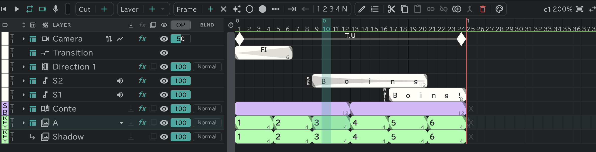

# Animation layers

The basic layer: you draw a drawing in each cell to make it move. **A** in a new project is this kind of layer.

## Blocks and cells

- One cell across is one frame. One colored **block** is one drawing, and the block's length is the number of commas that drawing shows for.
- The big number in a block is the **drawing name**; the small number at the block's end is its **length**.
- A cell without a block is an **empty cell** (nothing shows; × on the sheet).
- New layers are named **A · B · C …**, and their color label starts as **Layout Material**. → [Color labels and takes](/en/layer-labels)

## Making drawings

- Select a cell and press **＋** New Frame  on the **Frame** pill: a new drawing in that cell. Press it in the middle of a block and the block splits in two there.
- With **✦** (Auto-create Frames) on, just drawing in an empty cell makes a drawing.
- Drag the triangle at a block's end to change its length. Set the length of every selected block at once with **1 · 2 · 3 · 4 · N** commas . The blocks after it close up or move along by that much.
- **Push Blocks / Pull Blocks** opens or closes empty cells at the selected place.
- **×** (Clear) turns the selected cells into empty cells.

## Same name = same drawing

- Blocks with the same drawing name are **the same drawing**. Fix one and the other changes too (like the repeat notation on a sheet).
- Rename a block to a name that already exists, and you are asked about the **Frames to link**.
- **Paste linked**  pastes as the same drawing; **Paste independent**  pastes as a new drawing. To pull linked ones apart, use **Make independent**. → [Timeline](/en/timeline?id=shared-pill)
- **Auto Name** names the selected blocks in order, from a start number.

## The ＋ at the end of a run, hold and repeat

At both ends of a **run** — blocks lined up with no empty cell between them — sit a small **＋** and an end mark.

- **＋**: press it to add one drawing at the end, or drag it to add as many as you drag.
- Press the end mark to choose what happens to the empty cells outside the run. The result is filled with **faded blocks** up to the end (or the start) of the cut.

| End | What it does |
|---|---|
| None | The empty cells stay empty |
| **Hold** | The end drawing keeps showing to the end of the cut |
| **Repeat** | The whole run repeats to the end of the cut |
| **Repeat selection** | Only the selected part of the run repeats (when there is a selected range) |

Faded blocks are worked out again on their own as the run changes. Edit the run or change the cut's length, and they follow.

## In-between marks

Marks that instruct the inbetweens (the drawings in between). There are two: ○ and ●.

- **○ In-between Mark 1 · ● In-between Mark 2**: put on or take off the mark in the selected cells.
- **Auto-add In-between Marks**: set an interval n and ○/●, and the selected blocks get a mark every n commas from their head.
- **A drawing with no name** shows a mark instead of a name at the head of its block. Whether it shows as ○ or ● is chosen in [Preferences](/en/preferences) → **Display** → **Mark of an unnamed block** (the auto-add window also opens on this mark at first).

## What this layer can do

Be the base layer of attach layers · clipping · [onion skin](/en/onion-skin) · [effects and transform](/en/effects) · blend · opacity.
