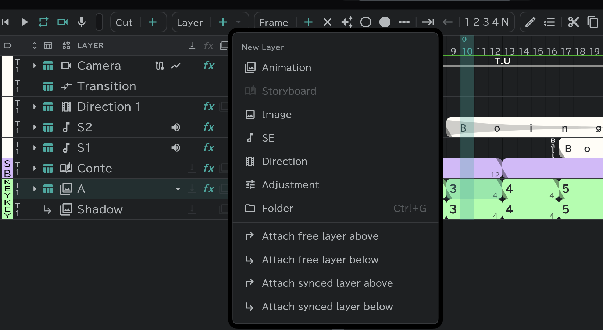

# Attach layers

A layer attached to a base layer: it follows the base's movement and effects, and keeps its own drawings. Use it for shadows and highlights.

- Select the base layer and, from **Layer ＋ ▾**, pick **Attach synced layer above** (or below) or **Attach free layer above** (or below). Dragging a layer onto another layer attaches it too.
- **Synced**: follows the base's timing as it is.
- **Free**: has its own timing.
- To take it off, use **Layer** → **Detach from base**.
- A new attach layer is numbered among the layers attached to the same base.
