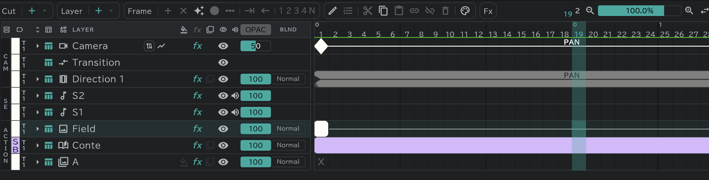

# Camera, direction, transition

The **CAM** section at the top of the timeline handles camerawork and scene changes. From the top, the order **camera · transition · direction** is fixed. All three go straight into the CAM column of the [timesheet](/en/sheets).

## Camera

A row that every cut has by itself, one each (named **Camera**). Select the camera row and the canvas switches to moving the camera.

### Moving it

- Set the camera's **Position · Scale** (zoom) **· Rotation** with keys. Open the row and the three become separate lanes. The canvas, playback and export all move with it.
- Drag or turn the camera frame directly on the canvas, and a key appears on that frame too.
- Keys are placed only inside that cut's frames. Change the cut's length and the last key follows the end.
- A key's speed (In · Out: Linear · Ease · Fast · Smooth · Hold) and **Influence**, and a position key's **Path** (Linear · Bezier · Continuous Bezier · Auto Bezier) and **Roving**, are set in the key edit window. → [Effects and transform](/en/effects?id=key-edit-window)
- Bend a Bezier path with its handles on the canvas.
- The camera row's **Graph** button shows the **Value · Speed** graphs.

### Instructions written for you

Between two keys, if the camera gets bigger, **T.U** is written on the camera row; if it gets smaller, **T.B**; if it otherwise moves or turns, **PAN** — and they go on the timesheet too. Nothing is written where it doesn't move.

### Camera view and camera path

- The camera row's **eye** = camera view (the same as **Camera view** next to the play button). Turn it on to darken everything outside the camera frame; the **opacity** beside it is how dark.
- The **Camera path** button at the end of the name draws the camera's route on the canvas.

| Item | Contents |
|---|---|
| Show | Off · **Space** (the route) · **Space + time** (a dot on the route for each frame) |
| Range | **All keys** · **Around playhead** |
| Dots every | How many frames apart the dots go |
| Either side | With Around playhead, how many frames before and after |

- Turn off the camera row's **FX** cell, and export and playback skip the camerawork (the camera frame stays put).
- The camera frame's size is set in **Settings** (⚙) → **Project settings** → **Camera** (shared by the whole project). → [Project settings](/en/settings)

## Transition

A row with **one per track** (named **Transition**). It puts scene changes between cuts.

| Mark | Meaning |
|---|---|
| FI · FO | Fade in from black · fade out to black |
| WI · WO | From white · to white |
| O.L | Changes by overlapping the previous cut (overlap) |

- Change the kind with **Edit**  and the length by dragging the block's end. It shows as is on the canvas, in playback and in export.
- The transition row's **eye** is whether the fades play. You can't rename, delete or move it.
- O.L spans two cuts, so you edit it on the [Conte panel](/en/storyboard).

## Direction

A row where you write camera instructions such as **PAN · FIX · T.U** as blocks (named **Direction 1** …; one or more per cut). It is notation for the sheet, so it doesn't move the picture.

- Make a block and open the **New instruction / Edit instruction** window with **Edit**.

| Item | Contents |
|---|---|
| Instruction (mark) | FIX · PAN · PAN UP · PAN DOWN · SL · Follow · T.U · T.B · Q T.U · Q T.B … |
| Name | When blank, the instruction's name |
| Start name (A) · End name (B) | What is written at A ⊢──⊣ B on the sheet (e.g. a PAN's start and end positions) |

- Add or change instructions with **Edit instructions** (name · icon · color · how it is drawn).
- You can draw on a direction row too. Onion skin works there as well.
- Direction rows can change order with each other. They are not linked across [linked cuts](/en/linked-cuts).
