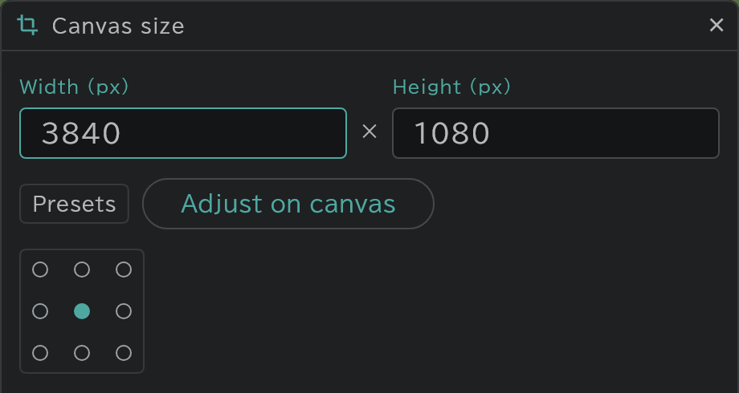

# Canvas size per cut

Each cut can have its own canvas size — make only the cut with the long pan background wide, for example.

- Press **Cut** at the top of the timeline → **Canvas size…**. It applies to the current cut; for a [linked cut](/en/linked-cuts), the cuts linked with it change too.
- Pick from **Presets** (A4 150 · 200 · 300dpi, HD · FHD · 2K · 4K) or type the width and height, and pick in the 3×3 grid where the existing drawing stays fixed.
- **Adjust on canvas** closes the window, and you drag the canvas's edges to resize it. The opposite edge stays fixed; confirm with the check or Enter.
- The camera moves with the drawing, so what the camera frames stays the same after resizing.
