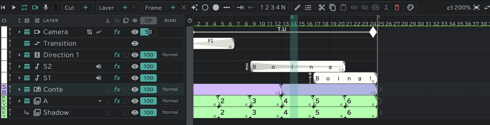

# Conte layer

The layer a cut's conte is drawn on — one per cut.

- Add it with **Layer ＋ ▾ → Storyboard** on the timeline, or press **＋** on the **Conte** row of the [conte](/en/storyboard) panel, in a cut that has no conte layer yet. The conte layer is made at the bottom of ACTION.
- One block is one picture on the [conte sheet](/en/sheets). **Frame ＋** inside a block divides it there.
- It has no empty cells: a block runs on to the next block or the end of the cut.
- Draw on the canvas, or straight onto the conte sheet.
- Cuts on the same track share the conte layer's name, colour label, opacity, blend, FX set-up and attach set-up. The cells and drawings are each cut's own.
