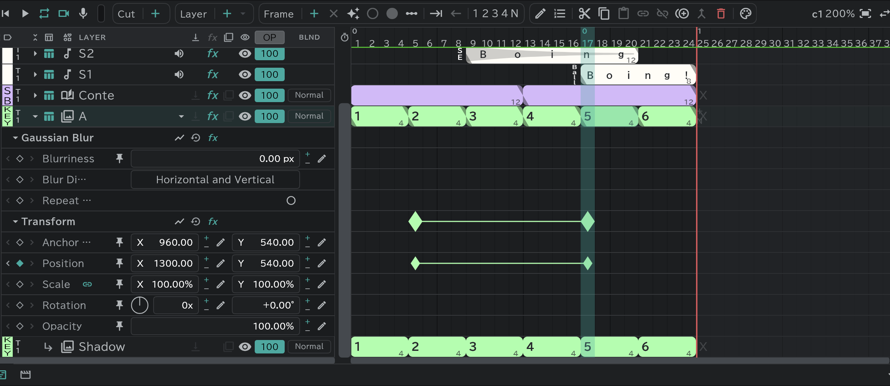
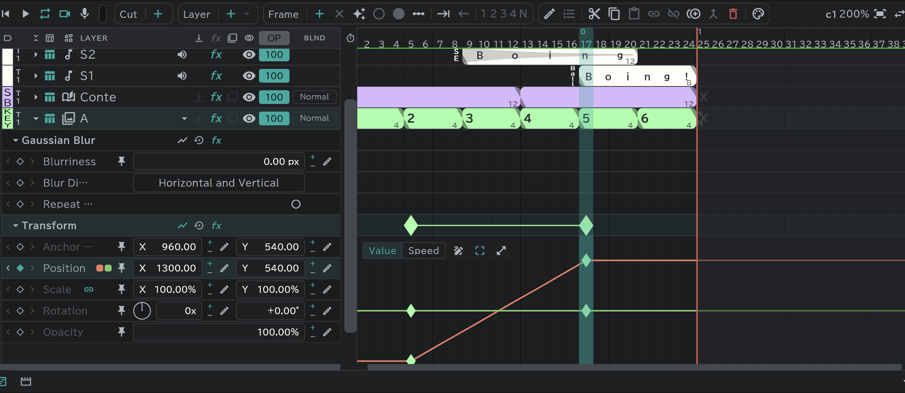

# Effects and transform

Press **▸** on a layer row to open that layer's **lanes**. One lane is one value; put **keys** (◆) on a lane and that value changes over time.

## Transform

Animation · storyboard · image · folder · SE layers have it.

- **Rotation** has two boxes, turns and degrees (450° = **1x** · **+90.00°**). Dragging round the dial in front of them turns it too.
- On the right of the head row: **Graph** · **Reset** (values back to where they started; the keys stay) · **fx** (bypass / apply).
- Grab that layer with the transform tool to change its position, size and rotation by hand on the canvas.

## Effects

Select a layer and add effects from the timeline's **Fx** button. On the [Conte panel](/en/storyboard), the Conte row (and its attach rows) takes them from the same button — put one on the Conte row and it appears in every cut of that track that has a conte.

| Effect | Values |
|---|---|
| **Brightness & Contrast** | Brightness · Contrast (−100–100) |
| **Hue/Saturation** | Master Hue (−180–180°) · Master Saturation · Master Lightness |
| **Gaussian Blur** | Blurriness · Blur Dimensions (Horizontal and Vertical / Horizontal / Vertical) · **Repeat Edge Pixels** (on, the canvas edges stay solid instead of turning transparent) |
| **Radial Blur** | Amount · Type (**Spin** / **Zoom**) · Center (drag the cross on the canvas) · Antialiasing (Best / Draft) |
| **Directional Blur** | Direction (angle) · Blur Length |
| **Camera Lens Blur** | Blur Radius (0–500) · Shape (Triangle – Decagon; Square at first) · Roundness · Aspect Ratio · Rotation · Diffraction Fringe (a ring bright only at its edge) · Repeat Edge Pixels |
| **Color Key** | Key Operation (**Key Colors**: erases the chosen color / **Keep Colors**: brings back the chosen color from what the key just before it erased) · key color · Tolerance · Amount |
| **Cel Number** | Stamps a cel number (A1 …) on the drawing · Position · Scale · Ink (animation · storyboard · image only) |

- They apply in order from the top. You can change the order freely.
- The **fx** cell on a layer row bypasses / applies all of that layer's effects at once.
- To remove one, select its head row and press **Delete**.
- To put one on every layer below, use an [adjustment layer](/en/adjustment-layers).
- Camera and transition rows have none. [Attach layers](/en/attach-layers) follow the base layer's transform and effects (attach layers on a storyboard layer have their own).
- **Layer FX** in [Export](/en/export): FX on / Basic only / FX off.

## Making keys

- Press **◆** on a lane at the playhead's frame and a key appears with the value there (press it again to remove it).
- On a lane that has keys, dragging the value, typing a number with the pencil button, or dragging a handle on the canvas also makes a key on that frame.
- Selecting a lane cell and pressing **Frame ＋** makes one too.
- Drag a key to move it in time. Copy · paste · delete work as for drawing blocks.

## Key edit window

Select a key and press **Edit** , or double-click the key.

| Item | |
|---|---|
| Name | Shared between linked cuts |
| In · Out | The speed coming in from the previous key · going out to the next. **Hold** keeps the value until the next key |
| Influence | How much of the span the change in speed covers |
| Path · Roving (position keys) | The way between keys · frees the key's time to pass at an even speed (not the first and last keys) |

The shape of the key mark changes with the speed you choose.

## Graph

The **Graph** button on a head row or a lane opens it under the lane.

- **Value / Speed**: switch between the value curve and the speed curve.
- Drag keys to move their value and time; use the handles to adjust the easing.
- **Pen** (when on, press on a curve to add a key — even when it's off, <kbd class="k-pc">Ctrl</kbd><kbd class="k-mac">⌘</kbd>+click) · **Transform box** (moves and stretches the selected keys with a box) · **Enlarge**.
- Drag an empty part to select the keys inside the box.
- **Pin to every graph**: keeps that lane overlaid while you look at other graphs.
