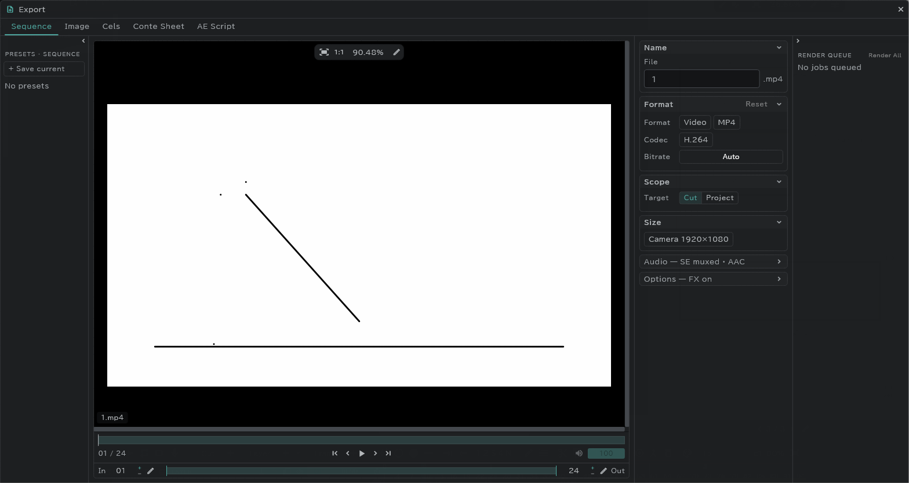
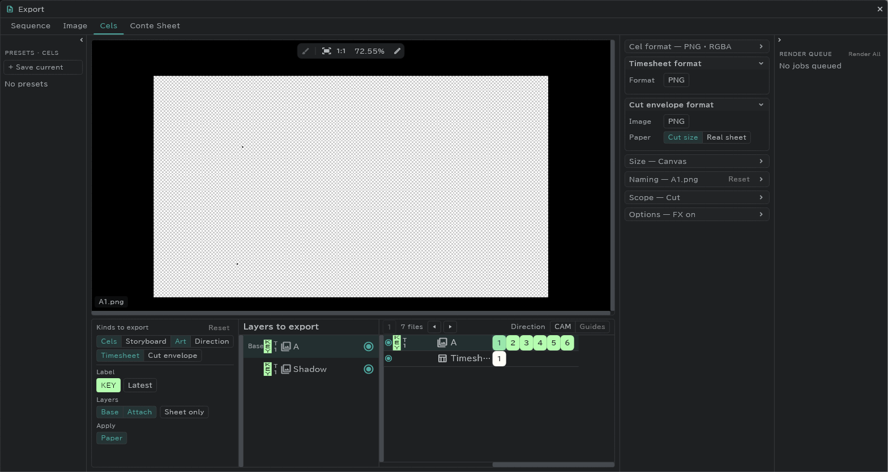

# Export

**Project** (folder) at the top left → **Export…** exports from one window.

- Tabs: **Sequence** (movie, numbered images) · **Image** · **Cels** · **Conte Sheet**
- The range (cut / project) and the size (camera / canvas) are chosen per tab.
- For a movie, pick the **Codec** (MP4: H.264 · H.265, MOV: H.264 · ProRes). Codecs this device cannot use show greyed out.
- Movies carry the sound on the SE rows (it can be turned off under **Audio**). Muted SE rows are left out.
- Type the file name in **Name** at the top of the settings; where it is saved is chosen when you press **Export**.
- While exporting, the window's settings are locked and only **Cancel** can be pressed.
- To keep just the current frame as an image, use **Project** → **Save as** → **PNG…** · **JPG…**.

## Cels

Each drawing goes out as one file (PNG or JPG). The timesheet and the cut envelope go out from here too.

- In **Kinds to export**, pick what goes out: cels, storyboard, art, direction, the timesheet, the cut envelope. The timesheet goes out as PNG, JPG or XDTS.
- In the list below the preview, turn each row and each drawing on or off.
- The strip above the list lays direction, the camera path and guides over the drawings.
- A file is named by its layer and the drawing's number (e.g. `A1.png`); folders, a prefix, digits and a suffix are set under **Naming**.
- An [attach layer](/en/attach-layers) comes out composited with its base, as one picture.
- [Colour labels](/en/layer-labels) and takes pick what goes out (e.g. only the latest take of the keys).
- A [linked cut](/en/linked-cuts) is handled as one cut. The timesheet comes out for each of the linked cuts.
