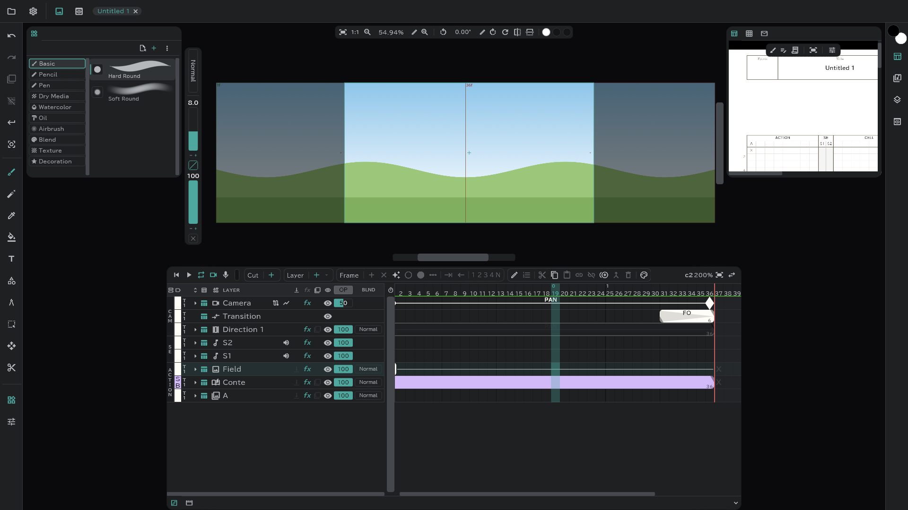

# Image layers

Place an image — a background, say — as a layer.

- Pick an image with **Project** (folder) at the top left → **Open File…**, or drag a file onto the window, and the **Import** window opens. Set **Into** (New layer · New cut · Media) for each row and press **Import**: the current cut gets an image layer.
- The file is registered in the [media pool](/en/media-pool) too. Bring it in with **Rasterize** on, and it is baked into a drawing and not kept in the pool.
- Numbered images such as `A1.png`, `A2.png` all come in as the frames of one layer, even if you pick only one. Set the range with IN/OUT in the preview.
- A PSD comes in with its layers kept.
- An image layer placed as the file itself is positioned with **Reference** (Position · Scale · Rotation) at the top of its lanes. Grab that row with the **Transform** tool and a box appears on the canvas.
