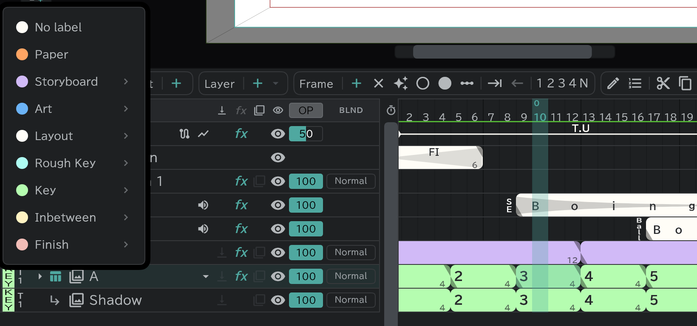

# Colour labels

Give each layer its stage (storyboard, layout, key, inbetween and so on) and its row and frame blocks take that colour.

- Press the label slot at the far left of a row and pick the stage. **▸** offers Material and revision stages such as Direction and Animation Director.
- The slot to the right of the label is the take (1–9). [Export](/en/export) uses it to pick only the latest take.
- Cuts can have a label too (**Cut** at the top of the timeline → **Layer mark**).
- Which stage a drawing is at reads at a glance on the timeline. Rows labelled inbetween are written into the CELL column of the [timesheet](/en/sheets).
