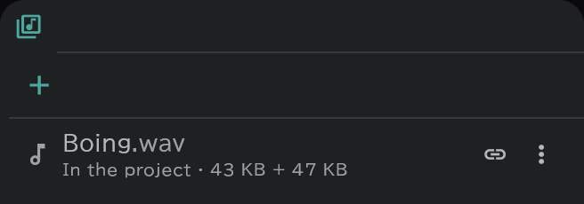

# Media panel and import

The **Media panel** (media pool) is where the pictures, sound, video and PDFs brought into the project are kept, and the **import window** is where you decide where and how files go in when you bring them in.

## The import window

Drop files onto the window, or use **Project** → **Open File** / **Open Folder**, or **＋** (Import) in the media panel to open it.

- The top row: whether to bring the chosen folder in as a **Cut** (the whole folder as one cut) or **Custom** (each row goes somewhere of its own), and the **Cut name** for a new cut.
- One file is one row. Columns: name · Modified · Size · Resolution, and what you set on each row:

| Column | What you pick |
|---|---|
| **Into** | New layer · New cut · SE row · Media (only registers it in the panel) · Excluded · "row · frame n" (that cell of an existing row) |
| **Rasterize** | On (bakes it into a canvas picture) / off (a [reference image](/en/image-layers) that points at the file) |
| **File** | **Keep** (holds it inside the project file) / **Link** (points at the outside file) |
| **Fit** | Original size · Fit, keep ratio · Stretch, ignore ratio |
| **Options** | PSD: Keep layers / Merge layers · movie: Picture + sound / Picture only / Sound only · numbered pictures: range |

- In the preview on the right, set the **IN / OUT** (the range to use) of a movie or numbered pictures.
- If something is wrong, **n warnings** appear at the bottom (for example, things that couldn't be brought in, such as a PSD's locks).
- If a movie's frame rate differs from the project's, you are asked whether to set the project to the movie's (the sound keeps its timing).
- Open a **cut folder** holding pictures, and cuts and layers are made following the folder structure. A row with one picture becomes an image layer, a row with several an animation layer; you can change it in the row's kind column.

## The media panel

Open it with the **Media** button on the right strip of the screen.

- Each row shows an **In the project / Linked** mark and the places that use that media (**Where it is used** — press one to go there).
- **Place**: **⋮ → Place** on a row, or drag the row onto the timeline, the canvas, the [Conte panel](/en/storyboard) or a viewer. Drop a picture on a cell of the [timesheet or conte sheet](/en/sheets) and it goes in as a photo.
- The **⋮** menu: Open in Viewer · Open in Sub Viewer · Place · Rename media · Relink · Keep inside the project file · Export as WAV (sound) · Delete media.
- If you delete media that is in use, you are asked first, since what you placed from it is deleted too.

## When linked files go missing

When original files kept as links are moved or deleted, **n media files not found** appears at the top of the panel.

- **Find in folder**: pick the folder the files moved to; the app looks in it, tells you how many it found, and asks whether to link them again.
- One at a time: **⋮ → Relink** on the row.
- For a project you are moving to another device, holding the originals with **Keep inside the project file** is safe.

## Writing on the viewer

Turn on **Allow Brush** at the top of the viewer, and you can write straight on pictures, movies and PDF pages kept in the project.
