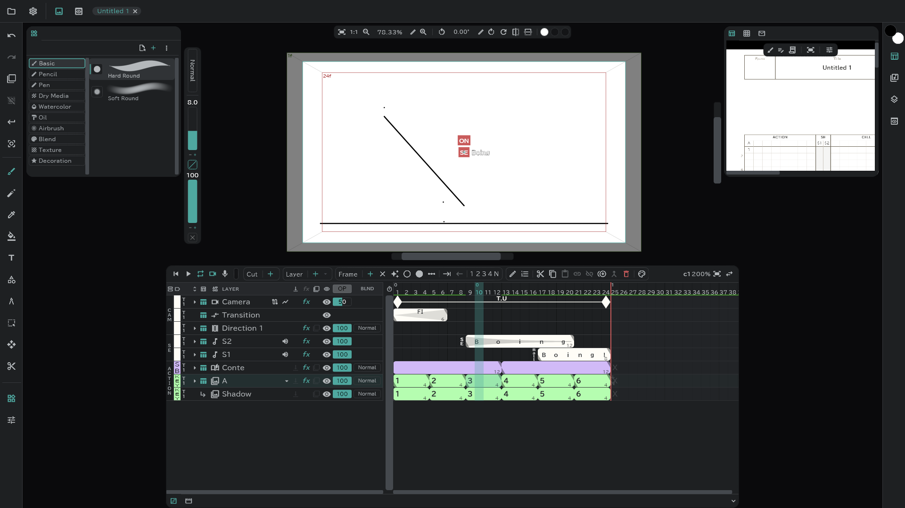
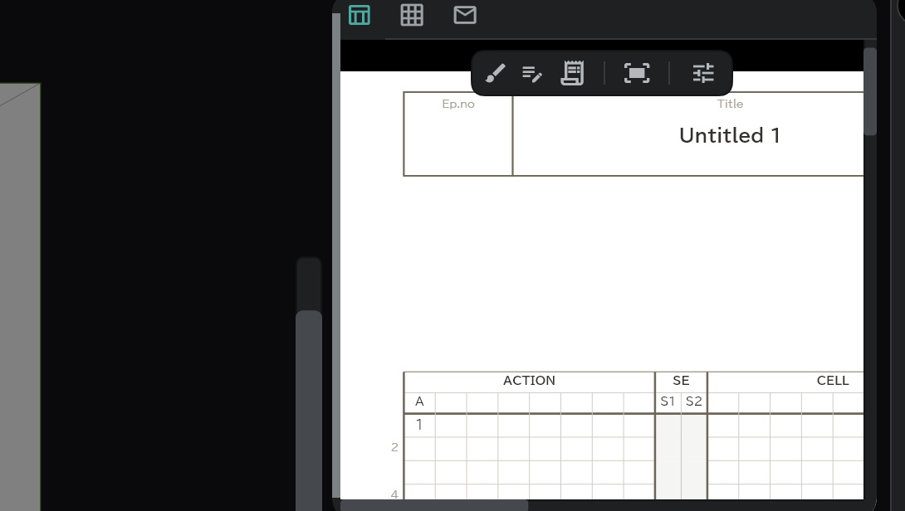
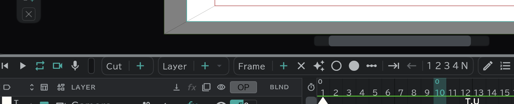

# Screen and panels

## The five parts of the screen

| Where | What is there |
|---|---|
| **Top strip** | **Project** (folder icon) menu · **Settings** (⚙) menu · Canvas/Viewer switch · tabs of the open projects |
| **Vertical strip on the left** | Undo · Redo · onion skin · Deselect · Confirm · solo buttons, and under them the [tools](/en/tools) |
| **Side strips** | Panel buttons. Press one and that panel opens beside the canvas |
| **Center** | The **Canvas** (where you draw) or the **Viewer** (where you watch movie and picture files) |
| **Bottom** | The **Timeline** panel and the **Conte** panel |

## Opening and closing panels

- One button on a side strip is one **panel group**. Press it to open the group, press it again to close it. You can open several groups at once; open groups stack from top to bottom.
- Hover over a button to see the names of the panels in its group.
- On a fresh install, the **Tool library** on the left and **Timesheet · Conte Sheet · Cut envelope** on the right are open.
- To take a panel off the screen completely, or to put it back, check it in **Settings** (⚙) → **Panels**.

This is where the panels start out.

| Button | Where | Panels |
|---|---|---|
|  | Left 1 | [Tool library](/en/tools) |
|  | Left 2 | [Tool settings](/en/tools) |
|  | Right 1 | [Colour wheel · RGB · Palette](/en/color) |
|  | Right 2 | [Timesheet · Conte Sheet · Cut envelope](/en/sheets) |
|  | Right 3 | [Media](/en/media-pool) |
|  | Right 4 | [Onion skin](/en/onion-skin) · Tool size |
|  | Right 5 | Sub Viewer |
|  | Center | Canvas · Viewer |
|  | Bottom | [Timeline](/en/timeline) · [Conte](/en/storyboard) |

## Moving panels

- Drag a panel's **tab** (its icon, at the top of the panel) onto another group's tab row, and the panel moves into that group. Drag it along the same row to change the order.
- Drop a tab on the **＋** (New panel group) slot of a side strip, and a new group with only that panel appears. A strip holds up to eight groups.
- When the tabs don't fit on the row, **+N** appears at the end. Press it to see the rest.
- The Canvas tab is fixed and does not move.
- To put the layout back the way it started, use **Settings** (⚙) → **Panels** → **Reset workspace layout**.

## Resizing

- Drag the canvas-side edge of an open panel to change its width, or the border between panels to change their height. Drag a corner to change both.

- Drag the top edge of the timeline/conte area at the bottom to change its height too. Press **Collapse** at the end of its tab row to fold it low, and **Expand** to bring it back (shortcut **Fold / unfold the timeline region**).

## The center: canvas and viewer

- Use the **Canvas / Viewer** switch on the top strip to choose what sits in the center. If you dragged another panel to the center, it shows up here too.
- The **Viewer** shows movie and picture files apart from your drawing (reference footage and so on). The **Sub Viewer** does the same in a side panel. Open a file by dropping it on the viewer, or with **Open in Viewer** in the [media panel](/en/media-pool).

## Changing the layout (Settings → Panels)

| Item | What it does |
|---|---|
| **Tool strip on the right** | Moves the tool strip to the right of the canvas |
| **Timeline region on top** | Puts the timeline/conte area at the top of the screen |
| **Brush values on the top strip** | Moves the brush size and opacity pill from the left of the canvas to the top strip |
| **Full screen** | (Desktop) uses the whole screen for the window |
| **Reset workspace layout** | Puts the panels back the way they started |

## Project tabs

- When you open several projects, they sit side by side as tabs on the top strip. Press a tab to switch, and **✕** to close it.

## The menus at a glance

**Project** (folder icon)

New project · Open File… · Open Folder · Save · Save as · Recent projects · Export → [Opening and saving](/en/files) · [Export](/en/export)

**Settings** (⚙)

| Item | Contents |
|---|---|
| Work settings | Title · Episode · Company logo · Cover picture · Staff → [Timesheet, conte sheet, cut envelope](/en/sheets) |
| Project settings | FPS · sample rate · camera size · playback mode → [Project settings](/en/settings) |
| Keyboard shortcuts | → [Shortcuts](/en/shortcuts) |
| Preferences | Input · Autosave · Audio · Language · Display · Memory → [Preferences](/en/preferences) |
| Panels | The panel list and layout above |
| About Anicel | Version |
