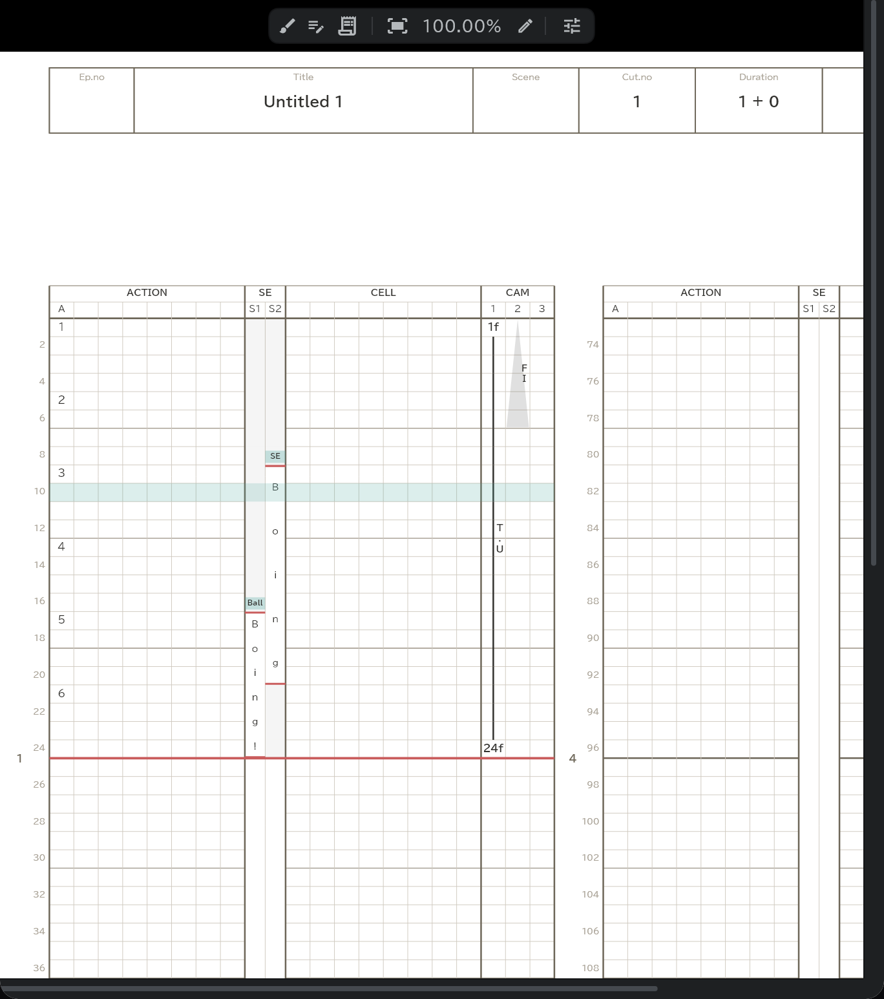
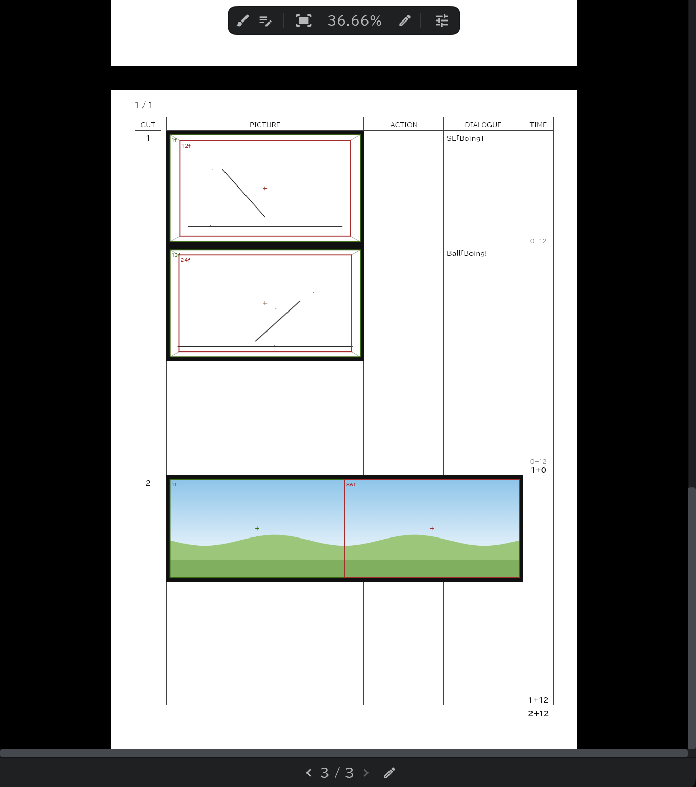

# Timesheet, conte sheet, cut envelope

Your work is printed on the paper forms as you go, so you work while seeing it **exactly as it will be exported**. One button on the right strip holds the three tabs (open from the start).

## For all three

- Turn pages on the strip at the bottom of the panel (previous · next, or drag the page number).
- Turn on the brush button at the top of the sheet (**Allow Brush**) and draw straight on it, as on paper. The brush, eraser and shape tools draw; press with any other tool and the sheet moves.
- Drag a picture from the [media panel](/en/media-pool) onto a cell of the sheet and it goes in as a photo. With Allow Brush on, grab a photo to move it and change its size and rotation.
- Press the title, episode, cut and name fields at the head to edit them in place. The whole work's title, episode, company logo, cover picture and staff are set in **Settings** (⚙) → **Work settings**.
- It is [exported](/en/export) as you see it.

## Timesheet

- Change drawings, dialogue or the camera on the timeline and the sheet is written on the spot. Rows whose [color label](/en/layer-labels) is Inbetween go into the CELL column; other drawing rows go into the ACTION column.
- The SE column gets the [SE](/en/sound-layers) names and dialogue; the CAM column gets the camera keys' names and moves (PAN · T.U · T.B) and the [direction](/en/camera-section) and [transition](/en/camera-section) rows.
- Which rows go on the sheet is set with the sheet arrow on each layer row. → [Layers at a glance](/en/layers)
- You can switch between two views: **Notation Sheet** (shortened with words such as repeat and *tome* (止め, a hold)) / **Data Sheet** (one cell at a time, exactly as exported).

**Sheet format**

| Item | Contents |
|---|---|
| Sheet length | 3 sec / 6 sec per sheet |
| Visible boxes | Which of the head's Title · Episode · Scene · Cut · Time · Name · Sheet boxes show |
| Stretch line · ACTION / CELL | On / Off + N — when the same drawing (*tome*) or × runs for N commas or more, draws a line from the (N+1)th comma |
| Empty SE stretches | Grayed / Blank |

## Conte sheet

- One block of the [storyboard layer](/en/conte-layer) is one panel of the sheet. Draw in a panel's picture area and it becomes that cut's conte drawing.

**Conte sheet format**

| Item | Contents |
|---|---|
| Form | Analog / Digital |
| Black frame round pictures | On / Off |
| Cover · Blank page | Included / Left out |

## Cut envelope

- Shows each cut's envelope (cut information · staff). A cut's staff is set in the **Cut** pill → **Cut settings**.
- Pick the form in **Envelope format**.
