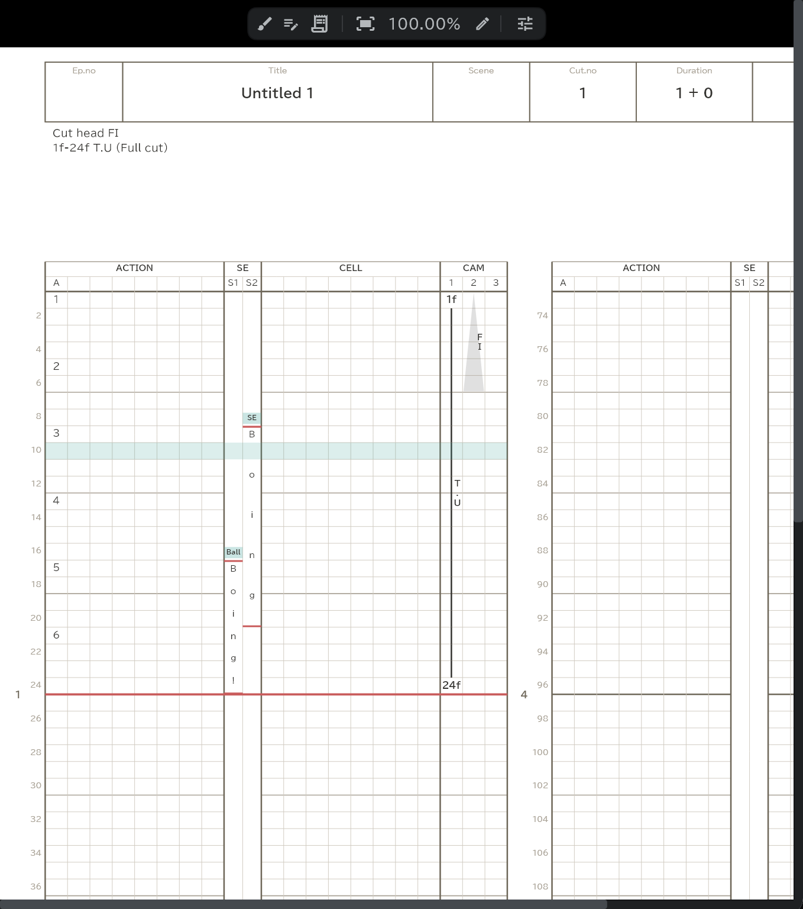
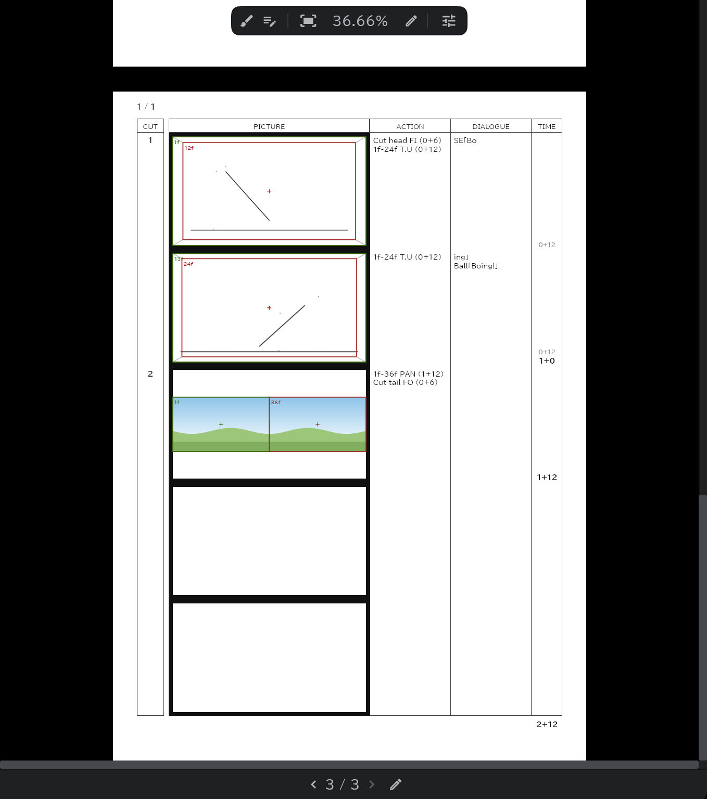

# Timesheet, conte sheet, cut envelope

Your work is printed on the paper forms as you go, so you work while seeing it **exactly as it will be exported**. One button on the right strip holds the three tabs (open from the start).

## For all three

- Turn pages on the strip at the bottom of the panel (previous · next, or drag the page number).
- Turn on the brush button at the top of the sheet (**Allow Brush**) and draw straight on it, as on paper. The brush, eraser and shape tools draw; press with any other tool and the sheet moves.
- Drag a picture from the [media panel](/en/media-pool) onto a cell of the sheet and it goes in as a photo. With Allow Brush on, grab a photo to move it and change its size and rotation.
- Press the title, episode, cut and name fields at the head to edit them in place. The whole work's title, episode, company logo, cover picture and staff are set in **Settings** (⚙) → **Work settings**.
- It is [exported](/en/export) as you see it.

## Timesheet

The timeline and the timesheet are fully in sync. You work with the timesheet live in front of you.

| Timeline section | What you do there | What goes on the timesheet |
|---|---|---|
| **ACTION** | Draw | The ACTION column (the CELL column for rows whose [color label](/en/layer-labels) is Inbetween) |
| **SE** | Make blocks with an [SE](/en/sound-layers)'s name and dialogue | Names and dialogue in the SE column |
| **CAM** | Edit the camera and shooting directions | In the CAM column: the camera keys' names and moves (PAN · T.U · T.B), and the [direction](/en/camera-section) and [transition](/en/camera-section) rows |

- The CAM section's moves and scene changes also go into the **memo column** as fixed text: the same lines as the conte sheet, without the times. The memo column has two sides; when the left fills up, it goes on from the top of the right.
- Which rows go on the sheet is set with the sheet arrow on each layer row. → [Layers at a glance](/en/layers)
- You can switch between two views: **Notation Sheet** (shortened with words such as repeat and *tome* (止め, a hold)) / **Data Sheet** (one cell at a time, exactly as exported).

**Sheet format**

| Item | Contents |
|---|---|
| Sheet length | 3 sec / 6 sec per sheet |
| Visible boxes | Which of the head's Title · Episode · Scene · Cut · Time · Name · Sheet boxes show |
| Stretch line · ACTION / CELL | On / Off + N — when the same drawing (*tome*) or × runs for N commas or more, draws a line from the (N+1)th comma |
| Empty SE stretches | Grayed / Blank |
| Fixed text | On / off, set overall and for the current cut |

## Conte sheet

The [Conte panel](/en/storyboard)'s timeline and the conte sheet are fully in sync. Storyboard work happens in the Conte panel, with no trip to the timeline panel.

| Conte panel section | What you do there | What goes on the conte sheet |
|---|---|---|
| **Conte** | Divide panels with the blocks of the [storyboard layer](/en/conte-layer) | One block is one panel of the sheet. Draw in a panel's picture area and it becomes that cut's conte drawing |
| **CAM** | Edit the camera and scene changes | The camera frames in the panel, and the moves (PAN · T.U · FIX) and scene changes (FI · FO · O.L) in the ACTION column. FI and FO are marked "Cut head" and "Cut tail", at the top of the first panel and the bottom of the last |
| **SE** | Make dialogue blocks | Names and dialogue in the dialogue column |

**Conte sheet format**

| Item | Contents |
|---|---|
| Form | Analog / Digital |
| Black frame round pictures | On / Off |
| Cover · Blank page | Included / Left out |
| Fixed text | On / off, set overall and for the current cut |
| Camera moves | Grow the cell / Keep in the cell, set overall and for the current cut |

## Cut envelope

- Shows each cut's envelope (cut information · staff). A cut's staff is set in the **Cut** pill → **Cut settings**.
- Pick the form in **Envelope format**.
