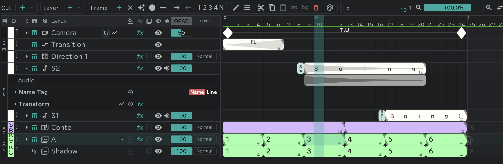

# Sound (SE) layers

The layer for sound effects and dialogue. Time them against the drawings by their waveform; the names and dialogue go straight onto the [timesheet](/en/sheets).

## SE rows

- The **SE** section of the timeline has two rows, **S1 · S2**, from the start. For more, use **Layer ＋ ▾ → SE** (on the Conte panel, just pressing **＋** makes an SE row).
- SE rows **belong to the whole track**. A sound that runs across cuts sits as one block, and it is the same row whichever cut you look from.

## One block = one sound

Make a block (**Frame ＋**) and open its window with **Edit**  or a double click.

| Item | Contents |
|---|---|
| Name | The speaker's name and so on. Leave it blank and the name tag box on the canvas is hidden |
| Type | **ON** (on screen) · **OFF** (off screen) · **MONO** (monologue) |
| Dialogue | The text written in the SE column of the sheet |
| Linked audio | The sound file this block plays |

## Bringing in sound

- **From a file**: drop a sound file onto the window, or **Project** → **Open File** → in the import window, set Into to **SE row**.
- **From the media panel**: that sound's menu → **Place**. → [Media panel and import](/en/media-pool)
- **Recording**: press the **microphone**  next to the play button to record from the playhead; press it again to stop, and the take is placed as an SE block. A take broken up because the input was too loud has a red block corner. → [Playback and recording](/en/playback)

## The waveform and the audio lane

- The waveform always shows faintly on SE blocks.
- In the **Audio** lane, opened with **▸**, slide the sound within the block to line it up, or drag its edges to fade it.

## Volume and mute (Layer Audio)

Press the **speaker** button beside an SE row's name to open that row's mixer: **Mute · Solo · Gain · Pan**.

## Name tags

A block's name also shows on the canvas as a **Name Tag**. The name tag keeps its place inside the camera frame.

- **Name Tag** lane: Size · Tracking · Bold · Italic · Underline · Strikethrough · Name Ink · Box Colour · Dialogue Ink · Show Dialogue.
- Name tags take **Transform**, blend and **Effects** like a layer.

## Good to know

- You don't draw on SE rows. They have no clipping either.
- SE rows themselves can't be copied and pasted.
- When you export a movie or sequence, choose **Mux the SE mix into the video** under **Audio** and the sound goes in with it. → [Export](/en/export)
