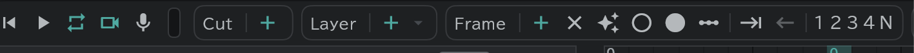

# Getting started

Step by step: open a new project, draw a few drawings, play them and save.

## 1. A new project

- When the app starts, a new project called **Untitled 1** opens. For another new project, use **Project** (folder icon) at the top left → **New project**.
- A new project already holds one cut, a drawing layer **A** and a drawing in its first cell, so you can start drawing right away.
- The middle of the screen is the **Canvas**, the bottom is the **Timeline**, and the vertical strip on the left holds the **Tools**. The name of each part is in [Screen and panels](/en/screen).

## 2. Drawing

- Pick the **Brush Tool**  on the tool strip at the left and draw on the canvas.
- Pick the kind of brush in the **Tool library** panel at the top left (Basic · Pencil · Pen · Watercolor …). More in [Brushes](/en/brushes).
- Change the brush **Size** and **Opacity** on the vertical pill at the left edge of the canvas. Drag the bar or press ±, and type a number with the pencil button beside it.
- The eraser is the **Eraser Tool** . To undo, press  or the arrow at the top of the tool strip.
- For a color, press the color button at the right edge (two overlapping circles) to open the [color panel](/en/color) and pick one.

## 3. Making the next drawing

On the timeline, one row is one layer and across is time (frames). One colored **block** is one drawing.

- On layer **A**'s row, press the cell for the new drawing, then press the **＋** of **Frame** at the top of the timeline: a new drawing appears in that cell.
- With **✦** (Auto-create Frames) on, just drawing in an empty cell makes a drawing.
- To see the previous drawing through while you draw, turn on **Toggle Onion Skin**  near the top of the tool strip. → [Onion skin](/en/onion-skin)
- Drag the end of a block to change how long that drawing shows (its number of commas).

## 4. Playback

- Press **▶** (play) at the bottom of the timeline to play, and press it again to stop. The loop, camera view and record buttons are there too. → [Playback and recording](/en/playback)

## 5. Saving

- Save with **Project** → **Save** . The first time, you choose a place and a name; the project is saved as one `.anicel` file.
- **Autosave is off at first.** While it is off, work you close without saving is not kept. Turn it on and the project file itself is saved at the interval you set (3–60 minutes). → [Preferences](/en/preferences) → **Autosave**
- To open it again, use **Project** → **Open File** or **Recent projects**. Dropping the file onto the window opens it too. → [Opening and saving](/en/files)

## Next

- Layer kinds and how to use them: [Layers at a glance](/en/layers)
- Lining up cuts and building the conte: [Conte panel](/en/storyboard)
- Exporting movies and cels: [Export](/en/export)
