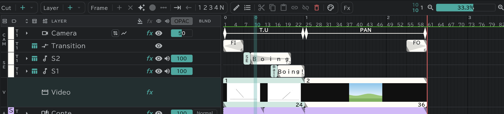

# Conte

Where the cuts are laid out. One block on the **Video** row is one cut, and cuts of different sizes play one after another.

- Conte work is done by making a [conte layer](/en/conte-layer) in each cut. Its cells show on the **Conte** row, just below **Video**; one cell is one picture on the [conte sheet](/en/sheets). Cells with no drawing yet show faint.
- On the **Video** row you select cuts, move them and change their length. On the **Conte** row you select cells and change their length. A double click on a block renames the cut or the cell.
- The camera row at the top of the CAM section shows each cut's camera keys and moves (PAN, T.U, T.B). The O.L [transition](/en/camera-section) is edited here.
- Drag the rail's rows to change their order.
