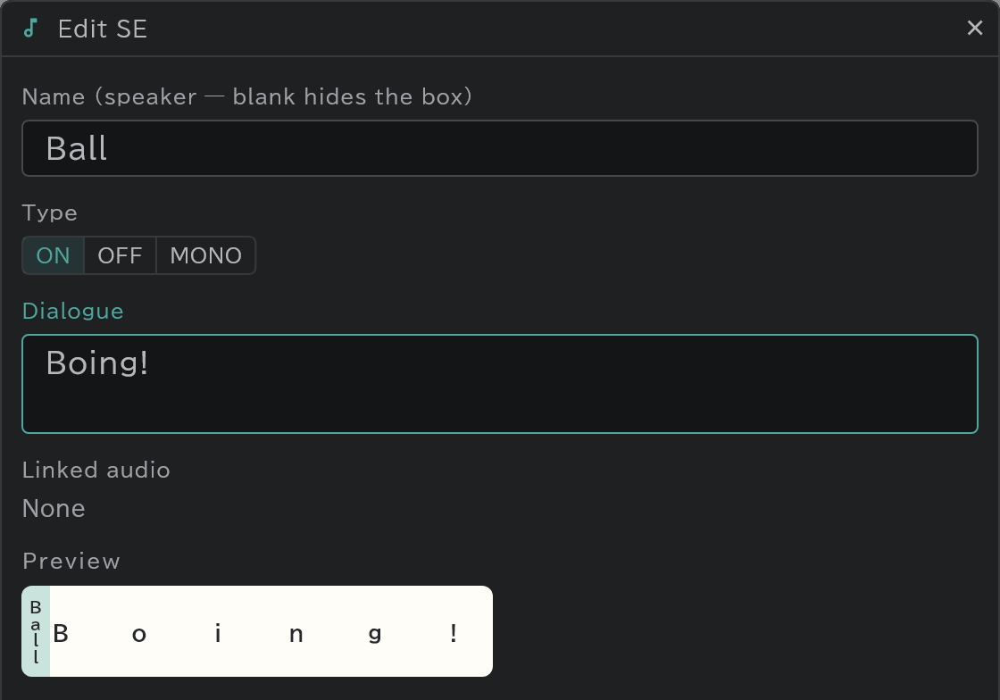

# Timeline

The panel for the current cut's layers and time. **One row is one layer; across is time (frames)**. The cells and kinds of a layer row are in [Layers at a glance](/en/layers).

- One block is one drawing. The big number is the drawing's name; the small number at the block's end is its length (in frames).
- The tabs at the bottom of the panel switch between the **Timeline** and the [Conte panel](/en/storyboard).

## The command bar at the top

| Where | Contents |
|---|---|
| Left |      → [Playback and recording](/en/playback) |
| Pills | **Cut** · **Layer** · **Frame** · **Shared** · **Fx** |
| Right | Cut name · zoom (drag left and right) · zoom to fit · **⇄** (Show X-sheet / Show timeline) |

## Selecting and moving

Blocks, cells, layers, keys and the cut blocks of the [Conte panel](/en/storyboard) all follow the same rules.

- **The first drag selects** (one or several, across several rows too).
- **Drag the selection again to move it.** A selection across several rows moves together, whichever row you grab.
- If a moved drawing lands on a drawing of the same name on its row, you are asked whether to link them.
- **Double-click** a block to open its edit window (see "Edit" below).

## Cut pill

| Action | Contents |
|---|---|
| ＋ New cut | A new cut after the current one |
| Edit cut note | A note on the cut |
| Layer mark | The cut label → [Color labels and takes](/en/layer-labels) |
| Cut settings | This cut's staff |
| Canvas size | → [Canvas size per cut](/en/canvas-size) |
| Create linked cut · Convert to linked cut | → [Linked cuts](/en/linked-cuts) |

Rename a cut on the [Conte panel](/en/storyboard): select its cut block and use **Edit** (or double-click). Change a cut's length by dragging the cut-end handle after the last block.

## Layer pill

| | Action | Key | |
|---|---|---|---|
|  | New Layer |  | Pick the kind with the ▾ beside it → [Layers at a glance](/en/layers) |

Press **Layer** for its menu — **Detach from base** · **Rasterize layer** · **Storyboard layer** (animation ⇄ storyboard).

## Frame pill

| | Action | Key | |
|---|---|---|---|
|  | New Frame |  | A new drawing in the selected cell (a new key on a lane) |
|  | Clear |  | Turns the selected cells into empty cells |
|  | Auto-create Frames |  | When on, just drawing in an empty cell makes a drawing |
|  | In-between Mark 1 |  | → [Animation layers](/en/animation-layers) |
|  | In-between Mark 2 |  |  |
|  | Auto-add In-between Marks |  | A mark every n commas |
|  | Push Blocks |  | Opens empty cells at the selected place |
|  | Pull Blocks |  | Closes the empty cells at the selected place |
|      | Set 1 · 2 · 3 · 4 · N Commas |  | Sets the length of the selected blocks at once (the blocks after them close up or move along) |

Press **Frame** for **Select whole row** (every block on that row).

## Shared pill

Whatever you selected (blocks · layers · keys · cuts), the same buttons answer.

| | Action | Key | |
|---|---|---|---|
|  | Edit |  | The edit window for what you selected ([below](/en/timeline?id=edit)) |
|  | Auto Name |  | Names the selected blocks in order, from a start number |
|  | Cut |  |  |
|  | Copy |  |  |
|  | Paste independent |  | Pastes as a new drawing |
|  | Paste linked |  | Pastes as the same drawing (fix one and both change) |
|  | Make independent |  | Pulls a linked drawing apart |
|  | Duplicate |  | Duplicates the selected layer (on the Conte panel, the cut) |
|  | Merge |  | Below |
|  | Delete |  | Deletes what you selected (the larger of cut > layer > cell) |
|  | Color Edit |  | Changes or erases the colors of the selected drawings → [Color](/en/color) |

**Merge** — makes the selected layers (two or more, or one folder) one layer — baked as they looked, becoming the topmost layer (one undo). If how it looks may change, it asks first. Merging a layer with attaches keeps the attaches you did not select attached to the result. Skipped for now: linked-cut, conte and reference-image layers, layers with a block that carries an instruction, attaches selected without their base, and a base that is not the topmost when it has attaches you did not select.

When the frame selection holds two or more blocks of one row, **Merge** makes them **one block**, row by row — from where the leftmost block starts to where the last one ends (covering the empty cells between), named after the leftmost block, with the leftmost block's drawing on top where they overlap (one undo).

## Edit

Select a block and press **Edit** , or double-click the block, and the window that fits what you selected opens.

| Selected | What you set in the window |
|---|---|
| A drawing block (animation · storyboard · image) | The drawing's name |
| An SE block | Name (speaker) · Type (ON · OFF · MONO) · Dialogue · Linked audio → [Sound (SE) layers](/en/sound-layers) |
| A direction block | Instruction (PAN and so on) · name · start · end → [Camera, direction, transition](/en/camera-section) |
| A transition block | The kind of change (FI · FO and so on) |
| A key on a lane | The key's name · speed · path · roving → [Effects and transform](/en/effects) |
| A layer | The layer's name (several at once) |
| A cut on the Conte panel | The cut's name |

## X-sheet

Press **⇄** (Show X-sheet) at the right end, and the timeline turns **vertical** like a paper timesheet (time runs from top to bottom; ACTION · SE · CAM columns from the left). It does the same as the timeline, and the arrow keys follow the sheet's directions. → [Shortcuts](/en/shortcuts)

## Zoom

- Drag the zoom number on the right left and right to change the cell width. **Timeline Zoom to Fit** fits the whole cut in the panel.
- Turn on [Preferences](/en/preferences) → **Display** → **Frame lines inside blocks**, and a vertical line is drawn for every frame inside blocks too.
