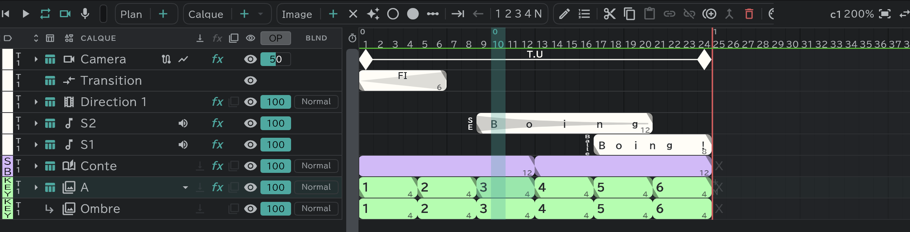

# Calques d'animation

Le calque de base : vous dessinez un dessin dans chaque case pour faire bouger. **A** dans un nouveau projet est un calque de ce type.

## Blocs et cases

- Une case horizontale = une image. Un **bloc** coloré = un dessin, et la longueur du bloc est le nombre de commas pendant lequel ce dessin s'affiche.
- Le grand nombre dans un bloc est le **nom du dessin** ; le petit nombre au bout du bloc est sa **durée**.
- Une case sans bloc est une **case vide** (rien ne s'affiche ; × sur la feuille).
- Les nouveaux calques s'appellent **A · B · C …**, et leur étiquette de couleur est au départ **Layout › Matériel**. → [Étiquettes de couleur et prises](/fr/layer-labels)

## Faire des dessins

- Sélectionnez une case et appuyez sur **＋** Nouvelle image  dans la pilule **Image** : un nouveau dessin dans cette case. Appuyez au milieu d'un bloc et le bloc se coupe en deux à cet endroit.
- Avec **✦** (Création auto d'images) activé, il suffit de dessiner dans une case vide pour créer un dessin.
- Faites glisser le triangle au bout d'un bloc pour changer sa durée. Réglez d'un coup la durée de tous les blocs sélectionnés avec **1 · 2 · 3 · 4 · N** commas . Les blocs suivants se resserrent ou se décalent d'autant.
- **Pousser (ouvrir des images) / Tirer (fermer des images)** ouvre ou ferme des cases vides à l'endroit sélectionné.
- **×** (Vider) transforme les cases sélectionnées en cases vides.

## Même nom = même dessin

- Les blocs qui portent le même nom de dessin sont **le même dessin**. Corrigez l'un et l'autre change aussi (comme la notation de répétition sur une feuille).
- Renommez un bloc avec un nom qui existe déjà, et l'application vous demande les **Images à lier**.
- **Coller lié**  colle comme le même dessin ; **Coller indépendant**  colle comme un nouveau dessin. Pour séparer des dessins liés, utilisez **Rendre indépendant**. → [Timeline](/fr/timeline?id=pilule-commune)
- **Nommer automatiquement** nomme les blocs sélectionnés dans l'ordre, à partir d'un numéro de départ.

## Le ＋ en bout de série, maintien et répétition

Aux deux bouts d'une **série** — des blocs alignés sans case vide entre eux — se trouvent un petit **＋** et une marque de fin.

- **＋** : appuyez pour ajouter un dessin au bout, ou faites glisser pour en ajouter autant que la distance glissée.
- Appuyez sur la marque de fin pour choisir ce que deviennent les cases vides hors de la série. Le résultat est rempli de **blocs estompés** jusqu'à la fin (ou au début) du plan.

| Fin | Effet |
|---|---|
| Aucun | Les cases vides restent vides |
| **Maintien** | Le dessin du bout reste affiché jusqu'à la fin du plan |
| **Répéter** | Toute la série se répète jusqu'à la fin du plan |
| **Répéter la sélection** | Seule la partie sélectionnée de la série se répète (quand une plage est sélectionnée) |

Les blocs estompés sont recalculés d'eux-mêmes quand la série change. Modifiez la série ou changez la durée du plan, et ils suivent.

## Repères d'intervalle

Des marques qui donnent les consignes pour les intervalles (les dessins entre deux). Il y en a deux : ○ et ●.

- **○ Repère d'intervalle 1 · ● Repère d'intervalle 2** : posent ou retirent le repère dans les cases sélectionnées.
- **Ajout auto de repères d'intervalle** : réglez un intervalle n et ○/●, et les blocs sélectionnés reçoivent un repère tous les n commas depuis leur début.
- **Un dessin sans nom** affiche un repère à la place d'un nom en tête de son bloc. Le choix entre ○ et ● se fait dans [Préférences](/fr/preferences) → **Display** → **Mark of an unnamed block** (la fenêtre d'ajout auto s'ouvre aussi sur ce repère au départ).

## Ce que ce calque peut faire

Servir de calque de base à des calques attachés · écrêtage · [pelure d'oignon](/fr/onion-skin) · [effets et transformation](/fr/effects) · fusion · opacité.
