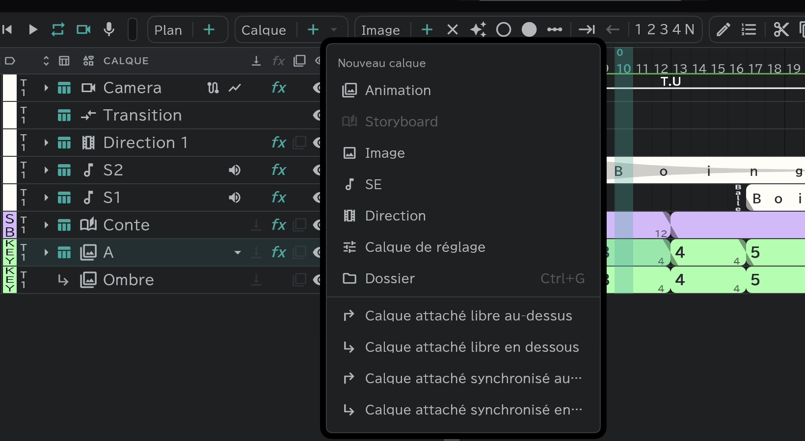

# Calques attachés

Un calque **attaché à un calque de base** : il suit le mouvement de la base mais garde ses propres dessins. Utilisez-le pour ce qui accompagne toujours le dessin principal, comme les ombres et les lumières.

## Attacher

- Sélectionnez le calque de base et choisissez **Calque attaché libre / synchronisé** **au-dessus / en dessous** dans **Calque ＋ ▾**.
- Vous pouvez aussi faire glisser un calque existant et le déposer **sur** le calque de base pour l'attacher (« attacher à {name} (synchronisé/libre) » s'affiche). Le déposer entre des calques déjà attachés l'attache aussi à cette base.
- Ce qui peut servir de base : calques d'animation · storyboard · image · direction (on ne peut pas attacher à un calque attaché).
- Le nom est celui du calque de base suivi d'un numéro — **A+1** quand il est attaché au-dessus, **A-1** quand il est attaché en dessous. Les numéros comptent les calques attachés à cette base.

## Synchronisé et libre

| | Synchronisé | Libre |
|---|---|---|
| Timing | **Suit** exactement les blocs du calque de base | Réglé **de lui-même** |
| Durée des blocs · repères | Non modifiables (ils changent quand vous modifiez le calque de base) | Libres |
| À utiliser quand | Chaque dessin a son propre dessin d'ombre | L'ombre change moins souvent que le dessin principal, etc. |

## Ce qui suit le calque de base

- **Transformation · effets** : un calque attaché n'a ni transformation ni effets à lui ; il porte ceux du calque de base (position · échelle · rotation · opacité · effets). Si vous attachez un calque qui a déjà des effets, l'application vous prévient d'abord que ces effets vont disparaître.
- **L'exception — les calques attachés à un [calque storyboard](/fr/conte-layer)** : ils gardent leur propre transformation et leurs propres effets, et ne portent pas ceux du calque storyboard. Utilisez-les pour donner à certains dessins leur propre mouvement ou leurs propres effets pendant que vous travaillez le conte.
- L'**étiquette de couleur** est héritée du calque de base.
- Repliez le calque de base et ils se replient avec lui ; supprimez le calque de base et ils sont supprimés avec lui.
- Ils ne vont pas sur la [feuille de temps](/fr/sheets) au départ. Pour en mettre un, appuyez sur la flèche de feuille de sa ligne.

## Dossiers d'attaches

Les calques attachés à une même base peuvent être rangés dans des dossiers — par exemple un par étape, comme la mise en scène et la direction de l'animation.

- Un dossier s'attache en le faisant glisser, comme un calque : déposez-le sur la ligne du calque de base, ou entre les calques déjà attachés. Un dossier vide s'attache aussi. Ensuite, déposez des calques attachés sur la ligne du dossier pour les y mettre.
- Un dossier d'attaches bouge avec son calque de base. Sa ligne n'a que l'**Œil, l'Opacité, la Fusion et le repli** ; il n'a ni transformation ni effets.
- Des dossiers peuvent y entrer. Un calque ordinaire déposé dedans devient une attache de cette base.
- Les attaches d'un [calque storyboard](/fr/conte-layer) peuvent aussi être rangées dans des dossiers, et le [panneau Conte](/fr/storyboard) les affiche comme la timeline (repli, retrait, glisser dedans).

## Détacher

Menu de la pilule **Calque** → **Détacher de la base**. Un calque détaché devient un calque ordinaire. Les calques attachés à un [calque storyboard](/fr/conte-layer) ne peuvent pas être détachés.
