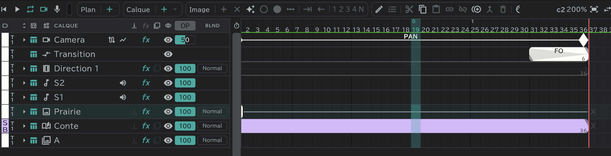

# Caméra, direction, transition

La section **CAM** en haut de la timeline gère le mouvement de caméra et les changements de scène. Depuis le haut, l'ordre **caméra · transition · direction** est fixe. Les trois vont directement dans la colonne CAM de la [feuille de temps](/fr/sheets).

## Caméra

Une ligne que chaque plan a d'office, une par plan (nommée **Camera**). Sélectionnez la ligne caméra et le canevas passe au déplacement de la caméra.

### La faire bouger

- Réglez la **Position · l'Échelle** (zoom) **· la Rotation** de la caméra avec des clés. Ouvrez la ligne et les trois deviennent des pistes séparées. Le canevas, la lecture et l'export bougent tous avec elle.
- Faites glisser ou tournez directement le cadre caméra sur le canevas : une clé apparaît aussi sur cette image.
- Les clés ne se placent qu'à l'intérieur des images de ce plan. Changez la durée du plan et la dernière clé suit la fin.
- La vitesse d'une clé (Entrée · Sortie : Linéaire · Lissage · Vite · Fluide · Maintien) et l'**Influence**, ainsi que la **Trajectoire** d'une clé de position (Linéaire · Bézier · Bézier continue · Bézier auto) et l'**Itinérance**, se règlent dans la fenêtre de modification de clé. → [Effets et transformation](/fr/effects?id=fenêtre-de-modification-de-clé)
- Courbez une trajectoire de Bézier avec ses poignées sur le canevas.
- Le bouton **Graphique** de la ligne caméra affiche les graphiques **Valeur · Vitesse**.

### Les indications écrites pour vous

Entre deux clés, si la caméra grossit, **T.U** s'écrit sur la ligne caméra ; si elle rapetisse, **T.B** ; si elle se déplace ou tourne autrement, **PAN** — et cela va aussi sur la feuille de temps. Rien ne s'écrit là où elle ne bouge pas.

### Vue caméra et trajectoire de la caméra

- L'**œil** de la ligne caméra = la vue caméra (la même que **Vue caméra** à côté du bouton de lecture). Activez-le pour assombrir tout ce qui est hors du cadre caméra ; l'**opacité** à côté règle le degré d'assombrissement.
- Le bouton **Trajectoire de la caméra** au bout du nom dessine le trajet de la caméra sur le canevas.

| Élément | Contenu |
|---|---|
| Affichage | Désactivé · **Espace** (le trajet) · **Espace + temps** (un point sur le trajet pour chaque image) |
| Plage | **Toutes les clés** · **Autour de la tête** |
| Points tous les | L'écart entre les points, en images |
| De chaque côté | Avec Autour de la tête, combien d'images avant et après |

- Désactivez la case **FX** de la ligne caméra, et l'export et la lecture ignorent le mouvement de caméra (le cadre caméra reste en place).
- La taille du cadre caméra se règle dans **Paramètres** (⚙) → **Réglages du projet** → **Caméra** (commune à tout le projet). → [Réglages du projet](/fr/settings)

## Transition

Une ligne avec **une par piste** (nommée **Transition**). Elle pose les changements de scène entre les plans.

| Marque | Sens |
|---|---|
| FI · FO | Ouverture au noir · fermeture au noir |
| WI · WO | Depuis le blanc · vers le blanc |
| O.L | Passe au plan suivant en le superposant au précédent (fondu enchaîné) |

- Changez le type avec **Modifier**  et la durée en faisant glisser le bout du bloc. Le résultat s'affiche tel quel sur le canevas, en lecture et à l'export.
- L'**œil** de la ligne transition indique si les fondus sont joués. On ne peut pas la renommer, la supprimer ni la déplacer.
- O.L s'étend sur deux plans : on le modifie donc dans le [panneau Conte](/fr/storyboard).

## Direction

Une ligne où l'on écrit des indications caméra comme **PAN · FIX · T.U** sous forme de blocs (nommée **Direction 1** … ; une ou plusieurs par plan). C'est une notation pour la feuille : elle ne fait pas bouger l'image.

- Créez un bloc et ouvrez la fenêtre **Nouvelle indication / Modifier l'indication** avec **Modifier**.

| Élément | Contenu |
|---|---|
| Indication (repère) | FIX · PAN · PAN UP · PAN DOWN · SL · Follow · T.U · T.B · Q T.U · Q T.B … |
| Nom | Vide, c'est le nom de l'indication |
| Nom de début (A) · Nom de fin (B) | Ce qui s'écrit en A ⊢──⊣ B sur la feuille (par ex. les positions de début et de fin d'un PAN) |

- Ajoutez ou changez des indications avec **Modifier les indications** (nom · icône · couleur · manière de la dessiner).
- On peut aussi dessiner sur une ligne de direction. La pelure d'oignon y fonctionne aussi.
- Les lignes de direction peuvent changer d'ordre entre elles. Elles ne sont pas liées entre [plans liés](/fr/linked-cuts).
