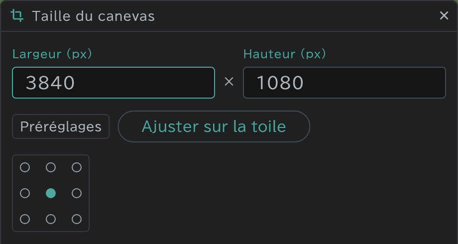

# Taille du canevas par plan

Chaque plan peut avoir sa propre taille de canevas. Par exemple, n'élargissez que le plan qui a besoin d'un long décor de PAN.

- Appuyez sur **Plan** en haut de la timeline → ouvrez **Taille du canevas**. Elle s'applique au plan courant, et s'il s'agit d'un [plan lié](/fr/linked-cuts), les plans qui lui sont liés changent aussi.
- Choisissez parmi les **Préréglages** (A4 150 · 200 · 300 dpi, HD · FHD · 2K · 4K) ou tapez une largeur et une hauteur, et choisissez dans la grille 3×3 où le dessin existant reste en place.
- Appuyez sur **Ajuster sur la toile** : la fenêtre se ferme pour que vous puissiez faire glisser les bords du canevas et le redimensionner. Le bord opposé à celui que vous faites glisser reste en place ; validez avec la coche ou Entrée.
- La caméra bouge avec le dessin : ce que montre le cadre reste le même quand vous redimensionnez.
