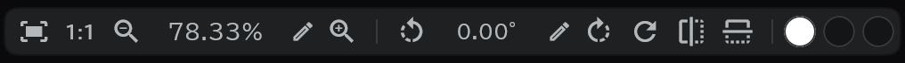

# Vue du canevas

## La pilule de vue

La pilule en bas du canevas. Quand la place manque, certains boutons passent dans **⚙**.

| | Bouton | Touche |
|---|---|---|
|  | Ajuster à la fenêtre |  |
|  | Réinitialiser le zoom (100 %) |  |
|  | Zoom arrière |  |
|  | Zoom avant |  |
|  | Pivoter la vue à gauche |  |
|  | Pivoter la vue à droite |  |
|  | Redresser la vue (0°) |  |
|  | Miroir horizontal |  |
|  | Miroir vertical |  |
|    | [Couleur du canevas · Couleur du fond · Couleur de l'arrière-plan](/fr/canvas-view?id=couleurs) | |

- Faites glisser le nombre de zoom ou d'angle vers la gauche et la droite pour le changer en douceur ; appuyez sur le crayon pour le saisir. Le zoom va de 10 à 1600 %.
- Les touches et ± avancent par crans fixes (10 · 25 · 50 · 75 · 100 · 125 · 150 · 200 · 300 · 400 · 800 · 1600 %), les touches de rotation par 15°. La molette de la souris zoome autour du curseur.
- Le miroir ne retourne que la vue (le dessin reste tel quel).

## La déplacer à la main

| Maintenir et glisser | |
|---|---|
|  | Déplace la vue |
|  | Fait pivoter la vue |

- Faire glisser les barres aux bords du canevas déplace aussi la vue.
- Les commandes au doigt et au stylet sont dans [Tactile et stylet](/fr/touch-pen).

## Fond

- Vous pouvez aussi dessiner hors du papier. Cette zone extérieure est le **Fond**. À l'export, elle est recadrée à la taille du papier.
- Dans la fenêtre **Couleur du fond**, choisissez si vous l'utilisez (Utilisé par défaut) et sa taille (1,5×, 2× ou 3× le papier, 3× par défaut).

## Couleurs

- **Couleur du canevas** : la couleur de base du papier (pour l'affichage seulement ; elle n'entre pas dans le dessin).
- **Couleur du fond** : la couleur hors du papier.
- **Couleur de l'arrière-plan** : la couleur de la fenêtre autour.

## Vue caméra

- Activez **Vue caméra** à côté du bouton de lecture de la timeline : tout ce qui est hors du cadre caméra est assombri. La lecture s'ajuste aussi au cadre caméra.
- Le degré d'assombrissement est l'opacité de la ligne caméra. → [Caméra, direction, transition](/fr/camera-section)

## Curseur

- Dans [Préférences](/fr/preferences) → **Display**, choisissez **Brush / Pen / Crosshair** (Crosshair par défaut). **Brush** montre la forme de la pointe du pinceau quand vous survolez avec la souris.
- Le curseur disparaît quand vous touchez l'écran avec un doigt.
