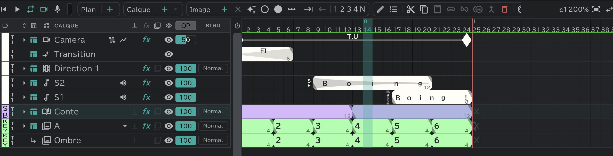

# Calque storyboard

Le calque sur lequel on dessine le conte d'un plan. Chaque plan en a **un** (nommé **Conte** ; son étiquette de couleur est au départ **Storyboard › Matériel**).

## En créer un

- **Calque ＋ ▾ → Storyboard** dans la timeline.
- Dans le [panneau Conte](/fr/storyboard), appuyez sur **＋** dans la ligne **Conte** au-dessus d'un plan qui n'a pas de calque storyboard.
- Pour transformer en calque storyboard un calque d'animation déjà dessiné : sélectionnez ce calque et cochez **Calque storyboard** dans le menu de la pilule **Calque**. Décochez et il redevient un calque d'animation (en tant que calque storyboard, ses cases vides sont remplies).
- Si le plan a déjà un calque storyboard, vous ne pouvez pas en créer un autre.

## Découper en vignettes

- **Un bloc = une vignette de la [feuille de conte](/fr/sheets)**.
- Il n'y a pas de cases vides. Un bloc va jusqu'au bloc suivant ou jusqu'à la fin du plan : il n'y a donc ni × (Vider), ni maintien, ni répétition.
- Appuyez sur **Image ＋** à l'intérieur d'un bloc pour couper la vignette à cet endroit. Faites glisser la limite entre deux blocs et les vignettes de chaque côté s'échangent de la durée.
- Dessinez sur le canevas, ou directement dans le panneau [Feuille de conte](/fr/sheets).

## Ce que partage toute la piste

Les plans d'une même piste partagent le **nom · l'étiquette de couleur · l'opacité · la fusion · la configuration des effets · la configuration des attaches** de leur calque storyboard. Changez-les dans un plan et tous les plans changent. Les vignettes et les dessins sont propres à chaque plan.

## Calques attachés au conte

Vous pouvez aussi attacher des [calques attachés](/fr/attach-layers) à un calque storyboard. Les calques attachés au conte ne peuvent pas être détachés.

## Export

- Exportez-le en PDF (vectoriel), PNG ou JPG depuis [Export](/fr/export) → **Feuille de conte**.
- Pour regarder le conte comme une vidéo, lisez-le dans le [panneau Conte](/fr/storyboard) ou exportez-le en séquence.
