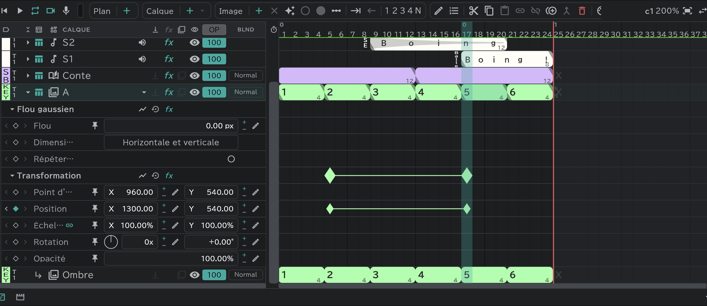
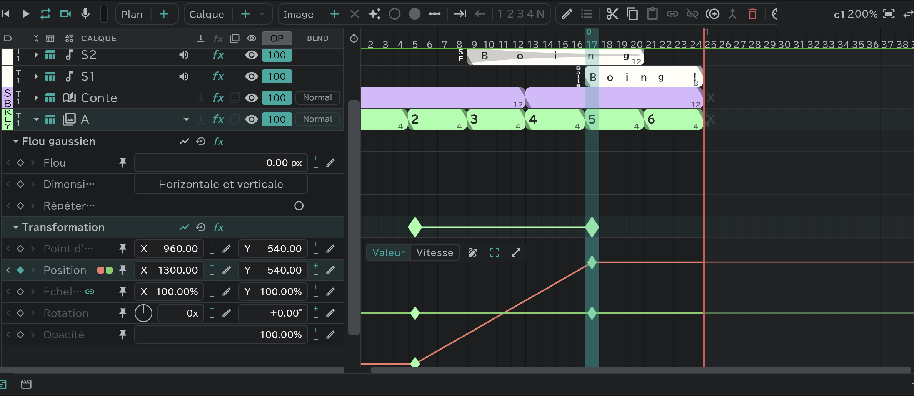

# Effets et transformation

Appuyez sur **▸** sur une ligne de calque pour ouvrir les **pistes** de ce calque. Une piste = une valeur ; posez des **clés** (◆) sur une piste et cette valeur change au fil du temps.

## Transformation

Les calques animation · storyboard · image · dossier · SE l'ont.

- **Rotation** a deux cases, tours et degrés (450° = **1x** · **+90.00°**). Tourner autour du cadran devant elles fait aussi tourner.
- À droite de la ligne de tête : **Graphique** · **Réinitialiser** (les valeurs reviennent au départ ; les clés restent) · **fx** (contourner / appliquer).
- Prenez ce calque avec l'outil transformation pour changer à la main sa position, sa taille et sa rotation sur le canevas.

## Effets

Sélectionnez un calque et ajoutez des effets depuis le bouton **Fx** de la timeline. Dans le [panneau Conte](/fr/storyboard), la ligne Conte (et ses lignes d'attaches) les prend depuis le même bouton — posez-en un sur la ligne Conte et il apparaît dans chaque plan de cette piste qui a un conte.

| Effet | Valeurs |
|---|---|
| **Luminosité/Contraste** | Luminosité · Contraste (−100–100) |
| **Teinte/Saturation** | Teinte globale (−180–180°) · Saturation globale · Luminosité globale |
| **Flou gaussien** | Flou · Dimensions du flou (Horizontale et verticale / Horizontale / Verticale) · **Répéter les pixels du contour** (activé, les bords du canevas restent pleins au lieu de devenir transparents) |
| **Flou radial** | Quantité · Type (**Rotation** / **Zoom**) · Centre (faites glisser la croix sur le canevas) · Anticrénelage (Optimal / Brouillon) |
| **Flou directionnel** | Direction (angle) · Longueur du flou |
| **Flou objectif appareil photo** | Rayon du flou (0–500) · Forme (Triangle – Décagone ; Carré au départ) · Arrondi · Format · Rotation · Frange de diffraction (un anneau lumineux seulement sur son bord) · Répéter les pixels du contour |
| **Masquage par couleur** | Opération (**Masquer** : efface la couleur choisie / **Conserver** : ramène la couleur choisie parmi ce que la clé juste avant a effacé) · Couleur de la clé · Tolérance · Quantité |
| **Numéro de cellulo** | Imprime un numéro de cellulo (A1 …) sur le dessin · Position · Échelle · Encre (animation · storyboard · image seulement) |

- Ils s'appliquent dans l'ordre depuis le haut. Vous pouvez changer l'ordre librement.
- La case **fx** d'une ligne de calque contourne / applique d'un coup tous les effets de ce calque.
- Pour en retirer un, sélectionnez sa ligne de tête et appuyez sur **Supprimer**.
- Pour en mettre un sur tous les calques en dessous, utilisez un [calque de réglage](/fr/adjustment-layers).
- Les lignes caméra et transition n'en ont pas. Les [calques attachés](/fr/attach-layers) suivent la transformation et les effets du calque de base (les calques attachés à un calque storyboard ont les leurs).
- **FX de calque** dans [Export](/fr/export) : FX activés / Base seule / FX désactivés.

## Créer des clés

- Appuyez sur **◆** sur une piste à l'image de la tête de lecture : une clé apparaît avec la valeur à cet endroit (appuyez de nouveau pour la retirer).
- Sur une piste qui a des clés, faire glisser la valeur, taper un nombre avec le bouton crayon ou faire glisser une poignée sur le canevas crée aussi une clé sur cette image.
- Sélectionner une case de piste et appuyer sur **Image ＋** en crée une aussi.
- Faites glisser une clé pour la déplacer dans le temps. Copier · coller · supprimer fonctionnent comme pour les blocs de dessin.

## Fenêtre de modification de clé

Sélectionnez une clé et appuyez sur **Modifier** , ou double-cliquez sur la clé.

| Élément | |
|---|---|
| Nom | Partagé entre plans liés |
| Entrée · Sortie | La vitesse en arrivant depuis la clé précédente · en partant vers la suivante. **Maintien** garde la valeur jusqu'à la clé suivante |
| Influence | La part de l'intervalle que couvre le changement de vitesse |
| Trajectoire · Itinérance (clés de position) | Le chemin entre les clés · libère le temps de la clé pour passer à vitesse régulière (sauf la première et la dernière clé) |

La forme du repère de clé change selon la vitesse choisie.

## Graphique

Le bouton **Graphique** d'une ligne de tête ou d'une piste l'ouvre sous la piste.

- **Valeur / Vitesse** : passe de la courbe de valeur à la courbe de vitesse.
- Faites glisser les clés pour déplacer leur valeur et leur temps ; utilisez les poignées pour régler l'accélération.
- **Plume** (activée, appuyez sur une courbe pour ajouter une clé — même désactivée, <kbd class="k-pc">Ctrl</kbd><kbd class="k-mac">⌘</kbd>+clic) · **Boîte de transformation** (déplace et étire les clés sélectionnées avec une boîte) · **Agrandir**.
- Faites glisser dans une zone vide pour sélectionner les clés dans la boîte.
- **Épingler à tous les graphiques** : garde cette piste superposée pendant que vous regardez d'autres graphiques.
