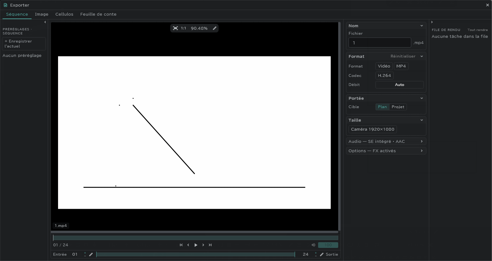
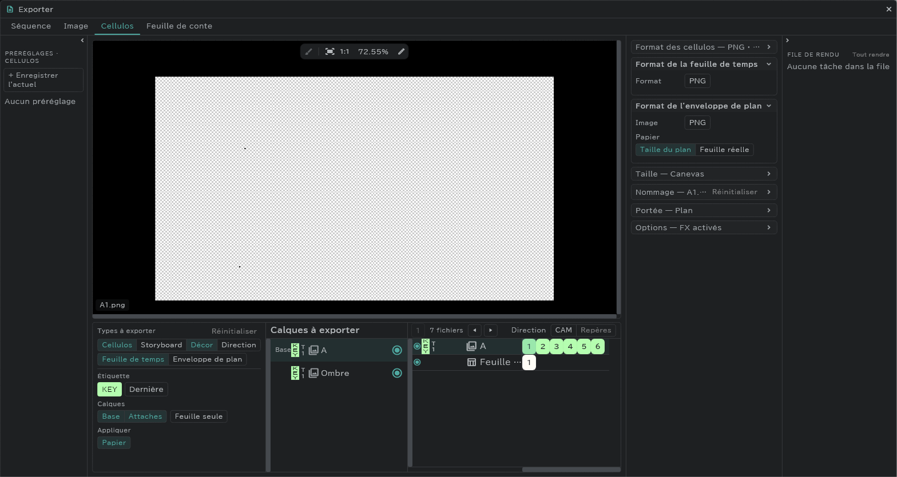

# Export

Tout s'exporte depuis une seule fenêtre : **Projet** (icône de dossier) en haut à gauche → **Exporter**.

## Onglets

| Onglet | Ce qu'il exporte |
|---|---|
| **Séquence** | Une vidéo (MP4 · MOV) ou des images numérotées |
| **Image** | L'image courante seule (PNG · JPG · PSD · BMP · TGA · TIFF · WEBP) |
| **Cellulos** | Un dessin = un fichier, plus la feuille de temps et l'enveloppe de plan |
| **Feuille de conte** | La feuille de conte en PDF (vectoriel) ou en PNG · JPG |

## Séquence (vidéos)

| Élément | Contenu |
|---|---|
| Nom | Le nom du fichier (pour des images numérotées, la règle de nommage) |
| Format | Images numérotées · **MP4** (H.264 · H.265) · **MOV** (H.264 · ProRes Proxy · LT · 422 · HQ · 4444) |
| Codec | Débit · Qualité · Canaux · Fond (Blanc / Noir, etc.) |
| Portée | **Plan** (le plan courant) / **Projet** (tous les plans) |
| Taille | **Caméra** (le cadre caméra) / **Canevas** / **Canevas (par plan)** |
| Audio | **Intégrer le mixage SE dans la vidéo** — inclut aussi le son des lignes SE (les lignes muettes sont exclues) |
| Options · FX de calque | FX activés / Base seule / FX désactivés |
| IN / OUT | Le passage à exporter, réglé dans l'aperçu |

- Les codecs que cet appareil ne peut pas utiliser apparaissent désactivés. Si **FFmpeg** est dans le PATH de cet ordinateur, vous pouvez exporter avec.
- Pendant l'export, les réglages de la fenêtre sont verrouillés et seul **Annuler** peut être pressé. Si vous annulez, la vidéo jusque-là est gardée.

## Cellulos

Exporte un dessin par fichier. La feuille de temps et l'enveloppe de plan s'exportent ici aussi.

| Élément | Contenu |
|---|---|
| Format des cellulos | PNG · JPG … |
| Format de la feuille de temps | PNG · JPG · XDTS |
| Format de l'enveloppe de plan · Taille | Taille du plan / Feuille réelle |
| Types à exporter | Cellulos · Storyboard · Décor · Direction · Feuille de temps · Enveloppe de plan |
| Étiquette | Choix par [étiquette de couleur](/fr/layer-labels) et par prise (Dernière / Prise n) — par ex. seulement la dernière prise de l'animation clé |
| Calques | **Base** (calques de base) · **Attaches** · **Feuille seule** (lignes mises sur la feuille de temps) · Personnalisé |
| Nommage | Dossiers (Projet / Plan / Calque) · Préfixe · Chiffres · Suffixe |
| Portée | Choix des plans (activez-les et désactivez-les dans la grille des plans) |

- Dans la liste sous l'aperçu, activez et désactivez les lignes et les dessins un par un.
- Sur la bande au-dessus de la liste, superposez direction, trajectoire de la caméra et repères aux dessins à l'export.
- Le nom du fichier est le nom du calque suivi du numéro du dessin (par ex. `A1.png`).
- Les [calques attachés](/fr/attach-layers) sortent fusionnés avec leur calque de base en une seule image.
- Les [plans liés](/fr/linked-cuts) sont traités comme un seul plan. La feuille de temps sort pour chaque plan lié.

## Feuille de conte

- **PDF vectoriel** : un PDF dont le texte et les traits ne se dégradent pas à l'agrandissement. Pour l'impression et la distribution.
- **Image de page** : PNG · JPG, une par page.

## Préréglages et file d'attente

- **Préréglages** : dans le tiroir des préréglages à côté de la fenêtre, nommez les réglages courants avec **+ Enregistrer l'actuel**, et appuyez plus tard sur l'un d'eux pour le charger.
- **File d'attente** : empilez plusieurs réglages avec **Ajouter à la file**, et exportez-les tous d'un coup avec **Tout rendre** dans le tiroir **File de rendu** (par ex. vidéo du plan + cellulos + feuille de temps).

## Où c'est enregistré

L'emplacement est demandé **quand vous appuyez sur Exporter**. Quelle fenêtre s'ouvre, et quand, dépend de l'**appareil** et du **nombre de fichiers produits**. La ligne à gauche d'Exporter (« Choisit l’emplacement, puis exporte » / « Exporte, puis choisit l’emplacement ») indique l'ordre de cet appareil.

| Appareil | Un fichier (image · vidéo · PDF de conte …) | Plusieurs fichiers · dossiers (cellulos · séquence · images de pages de conte …) |
|---|---|---|
| **Windows · Mac · Linux** | D'abord une **fenêtre d'enregistrement** → export | D'abord une **fenêtre de dossier** → export |
| **iPad · iPhone** | Export → puis la **fenêtre de partage** | Export → puis la **fenêtre de partage** (tout le dossier) |
| **Android** | Export → puis une **fenêtre d'enregistrement** | D'abord une **fenêtre de dossier** → export |

- Une **fenêtre de dossier** est la fenêtre du système qui choisit un dossier plutôt qu'un fichier.
- Quand la règle de nommage crée un dossier par plan ou par calque, même un seul fichier compte comme « plusieurs · dossiers ».
- Annulez la fenêtre qui s'ouvre après l'export et les résultats sont gardés : elle demande **[Choisir à nouveau] · [Abandonner]**.
- **File d'attente** : les appareils qui demandent avant demandent au moment d'**Ajouter à la file** ; les appareils qui demandent après demandent une fois, quand **Tout rendre** a fini.

### Exporter directement vers Google Drive

| Appareil | Un fichier | Plusieurs fichiers · dossiers |
|---|---|---|
| **Windows · Mac** | Oui — choisissez le dossier Drive que l'application de bureau Google Drive a créé sur le PC (sous Windows, en général le lecteur **G:**) | Oui — le même dossier |
| **Linux** | Choisissez le dossier Drive créé par un outil de synchronisation | Pareil |
| **iPad · iPhone** | Oui — Drive dans la fenêtre de partage | Oui — Drive dans la fenêtre de partage (tout le dossier) |
| **Android** | Oui — Drive dans la fenêtre d'enregistrement | **Non** — la fenêtre de dossier n'a pas Drive. Exportez dans un dossier de cet appareil, puis synchronisez-le avec une application de synchronisation (Autosync, etc.) |

## Juste une image, vite

Vous pouvez aussi garder l'image courante seule avec **Projet** → **Enregistrer sous** → **PNG · JPG …**. → [Ouvrir et enregistrer](/fr/files)
