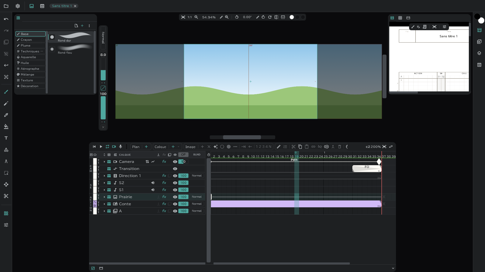

# Calques image

Un calque qui pose **une seule image sur tout le plan**, comme un décor (BG) ou un BOOK. Il s'appelle **BG**, ou **BOOK** s'il y a déjà un BG, et son étiquette de couleur est au départ **Décors › Matériel**.

## En créer un

- **Calque ＋ ▾ → Image** : un calque image vide. Dessinez directement dessus.
- **Depuis un fichier** : déposez un fichier image sur la fenêtre, ou choisissez-le avec **Projet** → **Ouvrir un fichier** : la fenêtre **Importer** s'ouvre. Réglez **Vers** (Nouveau calque · Nouveau plan · Médias …) sur chaque ligne et appuyez sur **Importer**. → [Panneau Médias et import](/fr/media-pool)
- **Depuis le panneau Médias** : le menu du média → **Placer**.

## Le fichier tel quel ou Pixelliser

Choisissez **Pixelliser** à l'import.

| | Pixelliser désactivé (référence) | Pixelliser activé |
|---|---|---|
| Ce qui va dans le calque | Une image qui **pointe vers** le fichier — à sa résolution d'origine | Une image **cuite** dans les pixels du canevas |
| Dessiner dessus | Non | Oui |
| Où la placer | **Référence** en haut des pistes (position · échelle · rotation) | Comme n'importe quel dessin |
| Panneau Médias | Elle y reste | Elle n'y reste pas |

- Un calque image de référence a un bouton fichier à côté de son nom. Appuyez dessus pour **Pixelliser** (vous pouvez cuire l'image plus tard).
- Prenez un calque de référence avec l'outil transformation : une boîte apparaît sur le canevas pour le déplacer à la main.

## Images numérotées, PSD, vidéos

- Choisissez un seul fichier d'une série numérotée comme `A1.png` · `A2.png`, et toute la série arrive. Comme une vidéo, **un seul calque de référence change au fil du temps** ; choisissez la plage avec IN/OUT dans l'aperçu. Pixelliser fait de chaque image un dessin.
- Pour un PSD, choisissez **Garder les calques** (calques et dossiers tels quels) ou **Fusionner les calques** (en une seule image).
- Pour une vidéo, choisissez **Image + son / Image seule / Son seul**.

## Bon à savoir

- Un calque image couvre tout le plan avec une seule image. Vous pouvez vider l'image, mais pas la découper en cases.
- Il n'a pas de pelure d'oignon. Écrêtage, fusion, effets et transformation fonctionnent.
- Entre [plans liés](/fr/linked-cuts), les calques image qui portent **le même nom** sont liés.
