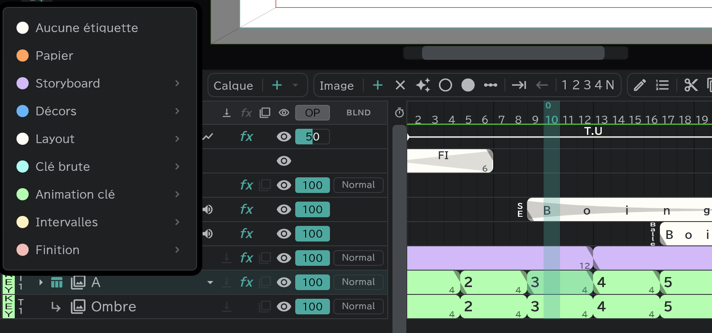

# Étiquettes de couleur et prises

Donnez à chaque calque son **étape** (storyboard · layout · animation clé · intervalles …) : sa ligne et ses blocs prennent la couleur de cette étape. Vous voyez d'un coup d'œil, dans la timeline, à quelle étape en est chaque dessin.

## Ajouter une étiquette

Appuyez sur la case **étiquette de couleur** tout à gauche d'une ligne et choisissez une étape.

| Étape | Sur la puce | Corrections possibles |
|---|---|---|
| Papier | PAP | (aucune) |
| Storyboard | SB | Réalisateur · Réalisateur en chef |
| Décors | ART | Mise en scène · Directeur d'animation · Directeur d'animation en chef · Réalisateur · Réalisateur en chef · Directeur d'animation action |
| Layout | LO | 〃 |
| Clé brute | RK | 〃 |
| Animation clé | KEY | 〃 |
| Intervalles | IB | les six ci-dessus + **Contrôle intervalles** |
| Finition | FIN | les six ci-dessus + **Contrôle cellulos** |

- Quand vous choisissez une étape, son **Matériel** (la version de travail de cette étape) et ses étapes de **correction** s'ouvrent à côté. La puce affiche les deux ensemble, comme « LO AD ».
- Effacez-la avec **Aucune étiquette**.
- Les nouveaux calques naissent avec une étiquette selon leur type : animation = Layout › Matériel, storyboard = Storyboard › Matériel, image = Décors › Matériel.
- Les [calques attachés](/fr/attach-layers) héritent de l'étiquette du calque de base.

## Étiquettes de plan

Vous pouvez aussi étiqueter tout un plan : menu de la pilule **Plan** en haut de la timeline → **Repère de calque**. Les [plans liés](/fr/linked-cuts) partagent la même étiquette.

## Prises

La case à droite de l'étiquette est la **Prise** (T1–T9, T1 au départ). Augmentez le numéro quand vous redessinez la même étape.

## Où servent les étiquettes

- **Solo par couleur** : la case étiquette de couleur de la ligne du haut de l'en-tête → ne garde que les lignes de l'étape choisie (annulez avec **Effacer le filtre de repères**).
- **Export** : dans [Export](/fr/export) → **Cellulos**, choisissez les lignes à exporter par étiquette et par prise (Dernière / Prise n).
- **Équipe** : dans **Paramètres** → **Réglages de l’œuvre**, et dans les **Réglages du plan** d'un plan, écrivez qui est responsable de chaque étape. → [Feuille de temps, feuille de conte, enveloppe de plan](/fr/sheets)
