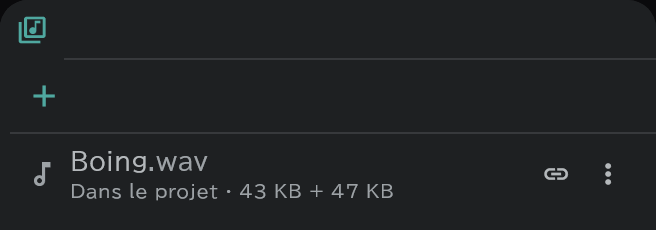

# Panneau Médias et import

Le **panneau Médias** (la réserve de médias) est l'endroit où sont gardés les images, sons, vidéos et PDF apportés dans le projet, et la **fenêtre d'import** est l'endroit où vous décidez où et comment les fichiers entrent quand vous les apportez.

## La fenêtre d'import

Déposez des fichiers sur la fenêtre, ou utilisez **Projet** → **Ouvrir un fichier** / **Ouvrir un dossier**, ou **＋** (Importer) dans le panneau Médias pour l'ouvrir.

- La rangée du haut : apporter le dossier choisi en **Plan** (tout le dossier en un seul plan) ou en **Personnalisé** (chaque ligne va à sa propre place), et le **Nom du plan** pour un nouveau plan.
- Un fichier = une ligne. Colonnes : nom · Modifié · Taille · Résolution, et ce que vous réglez sur chaque ligne :

| Colonne | Ce que vous choisissez |
|---|---|
| **Vers** | Nouveau calque · Nouveau plan · Ligne SE · Médias (l'enregistre seulement dans le panneau) · Exclu · « ligne · image n » (cette case d'une ligne existante) |
| **Pixelliser** | Activé (cuit en image du canevas) / désactivé (une [image de référence](/fr/image-layers) qui pointe vers le fichier) |
| **Fichier** | **Intégrer** (le garde dans le fichier du projet) / **Lier** (pointe vers le fichier extérieur) |
| **Ajuster** | Taille d’origine · Ajuster, proportions gardées · Étirer, proportions ignorées |
| **Options** | PSD : Garder les calques / Fusionner les calques · vidéo : Image + son / Image seule / Son seul · images numérotées : plage |

- Dans l'aperçu à droite, réglez l'**IN / OUT** (la plage à utiliser) d'une vidéo ou d'images numérotées.
- En cas de problème, **n avertissements** s'affiche en bas (par exemple ce qui n'a pas pu être apporté, comme les verrouillages d'un PSD).
- Si la cadence d'une vidéo diffère de celle du projet, l'application demande s'il faut régler le projet sur celle de la vidéo (le son garde son timing).
- Ouvrez un **dossier de plan** contenant des images : les plans et les calques sont créés selon la structure du dossier. Une ligne avec une seule image devient un calque image, une ligne avec plusieurs un calque d'animation ; vous pouvez le changer dans la colonne du type de la ligne.

## Le panneau Médias

Ouvrez-le avec le bouton **Médias** de la bande de droite de l'écran.

- Chaque ligne affiche une marque **Dans le projet / Lié** et les endroits qui utilisent ce média (**Utilisations** — appuyez sur l'un d'eux pour y aller).
- **Placer** : **⋮ → Placer** sur une ligne, ou faites glisser la ligne sur la timeline, le canevas, le [panneau Conte](/fr/storyboard) ou une visionneuse. Déposez une image sur une case de la [feuille de temps ou de la feuille de conte](/fr/sheets) et elle y entre comme photo.
- Le menu **⋮** : Ouvrir dans la visionneuse · Ouvrir dans la visionneuse secondaire · Placer · Renommer le média · Relier · Conserver dans le fichier de projet · Exporter en WAV (son) · Supprimer le média.
- Si vous supprimez un média utilisé, l'application demande d'abord, car ce que vous avez placé à partir de lui est supprimé aussi.

## Quand des fichiers liés manquent

Quand des fichiers d'origine gardés en lien sont déplacés ou supprimés, **n fichiers multimédias introuvables** s'affiche en haut du panneau.

- **Chercher dans un dossier** : choisissez le dossier où les fichiers ont été déplacés ; l'application y cherche, indique combien elle en a trouvé, et demande s'il faut les relier.
- Un par un : **⋮ → Relier** sur la ligne.
- Pour un projet que vous emportez sur un autre appareil, garder les originaux avec **Conserver dans le fichier de projet** est le plus sûr.

## Écrire sur la visionneuse

Activez **Autoriser le pinceau** en haut de la visionneuse : vous pouvez écrire directement sur les images, les vidéos et les pages PDF gardées dans le projet.
