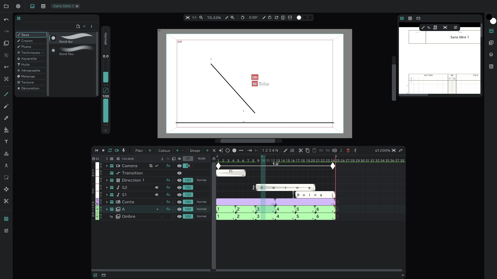
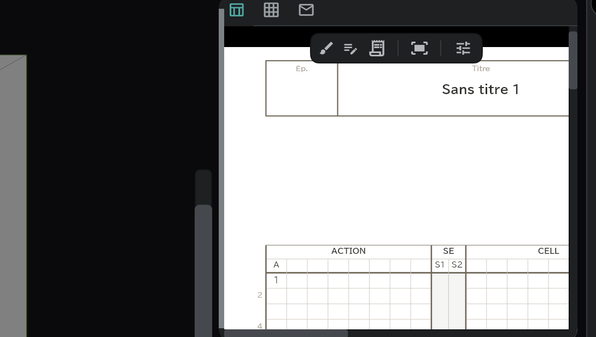
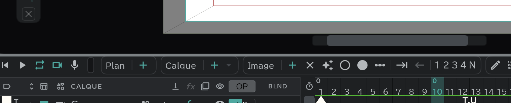

# Écran et panneaux

## Les cinq parties de l'écran

| Où | Ce qui s'y trouve |
|---|---|
| **Bandeau du haut** | Menu **Projet** (icône de dossier) · menu **Paramètres** (⚙) · bascule Canevas/Visionneuse · onglets des projets ouverts |
| **Bande verticale à gauche** | Annuler · Rétablir · pelure d'oignon · Désélectionner · Valider · boutons solo, et en dessous les [outils](/fr/tools) |
| **Bandes latérales** | Boutons de panneaux. Appuyez sur l'un d'eux et ce panneau s'ouvre à côté du canevas |
| **Centre** | Le **Canevas** (où l'on dessine) ou la **Visionneuse** (où l'on regarde les fichiers vidéo et image) |
| **Bas** | Le panneau **Timeline** et le panneau **Conte** |

## Ouvrir et fermer les panneaux

- Un bouton d'une bande latérale = un **groupe de panneaux**. Appuyez dessus pour ouvrir le groupe, appuyez de nouveau pour le fermer. Vous pouvez ouvrir plusieurs groupes à la fois ; les groupes ouverts s'empilent de haut en bas.
- Survolez un bouton pour voir les noms des panneaux de son groupe.
- À la première installation, la **Bibliothèque d'outils** à gauche et **Feuille de temps · Feuille de conte · Enveloppe de plan** à droite sont ouverts.
- Pour retirer complètement un panneau de l'écran, ou pour le remettre, cochez-le dans **Paramètres** (⚙) → **Panneaux**.

Voici où se trouvent les panneaux au départ.

| Bouton | Où | Panneaux |
|---|---|---|
|  | Gauche 1 | [Bibliothèque d'outils](/fr/tools) |
|  | Gauche 2 | [Réglages de l'outil](/fr/tools) |
|  | Droite 1 | [Roue chromatique · RVB · Palette](/fr/color) |
|  | Droite 2 | [Feuille de temps · Feuille de conte · Enveloppe de plan](/fr/sheets) |
|  | Droite 3 | [Médias](/fr/media-pool) |
|  | Droite 4 | [Pelure d'oignon](/fr/onion-skin) · Taille de l'outil |
|  | Droite 5 | Visionneuse secondaire |
|  | Centre | Canevas · Visionneuse |
|  | Bas | [Timeline](/fr/timeline) · [Conte](/fr/storyboard) |

## Déplacer les panneaux

- Faites glisser l'**onglet** d'un panneau (son icône, en haut du panneau) sur la rangée d'onglets d'un autre groupe : le panneau passe dans ce groupe. Faites-le glisser le long de la même rangée pour changer l'ordre.
- Déposez un onglet sur la case **＋** (Nouveau groupe de panneaux) d'une bande latérale : un nouveau groupe ne contenant que ce panneau apparaît. Une bande contient jusqu'à huit groupes.
- Quand les onglets ne tiennent pas sur la rangée, **+N** apparaît au bout. Appuyez dessus pour voir les autres.
- L'onglet Canevas est fixe et ne bouge pas.
- Pour remettre la disposition comme au départ, utilisez **Paramètres** (⚙) → **Panneaux** → **Réinitialiser l'espace de travail**.

## Redimensionner

- Faites glisser le bord côté canevas d'un panneau ouvert pour changer sa largeur, ou la limite entre deux panneaux pour changer leur hauteur. Faites glisser un coin pour changer les deux.

- Faites glisser le bord supérieur de la zone timeline/conte en bas pour changer aussi sa hauteur. Appuyez sur **Réduire** au bout de sa rangée d'onglets pour la replier, et sur **Développer** pour la rouvrir (raccourci **Replier / déplier la zone de timeline**).

## Le centre : canevas et visionneuse

- Utilisez la bascule **Canevas / Visionneuse** du bandeau du haut pour choisir ce qui occupe le centre. Si vous avez glissé un autre panneau au centre, il apparaît ici aussi.
- La **Visionneuse** affiche des fichiers vidéo et image à part de votre dessin (vidéos de référence, etc.). La **Visionneuse secondaire** fait de même dans un panneau latéral. Ouvrez un fichier en le déposant sur la visionneuse, ou avec **Ouvrir dans la visionneuse** dans le [panneau Médias](/fr/media-pool).

## Changer la disposition (Paramètres → Panneaux)

| Élément | Effet |
|---|---|
| **Barre d'outils à droite** | Place la bande d'outils à droite du canevas |
| **Zone de timeline en haut** | Place la zone timeline/conte en haut de l'écran |
| **Valeurs du pinceau dans le bandeau du haut** | Déplace la pilule de taille et d'opacité du pinceau de la gauche du canevas vers le bandeau du haut |
| **Plein écran** | (Ordinateur) la fenêtre occupe tout l'écran |
| **Réinitialiser l'espace de travail** | Remet les panneaux comme au départ |

## Onglets de projet

- Quand vous ouvrez plusieurs projets, ils se placent côte à côte en onglets dans le bandeau du haut. Appuyez sur un onglet pour changer de projet, et sur **✕** pour le fermer.

## Les menus en bref

**Projet** (icône de dossier)

Nouveau projet · Ouvrir un fichier · Ouvrir un dossier · Enregistrer · Enregistrer sous · Projets récents · Exporter → [Ouvrir et enregistrer](/fr/files) · [Export](/fr/export)

**Paramètres** (⚙)

| Élément | Contenu |
|---|---|
| Réglages de l’œuvre | Titre · Épisode · Logo du studio · Image de couverture · Équipe → [Feuille de temps, feuille de conte, enveloppe de plan](/fr/sheets) |
| Réglages du projet | FPS · fréquence d'échantillonnage · taille de la caméra · mode de lecture → [Réglages du projet](/fr/settings) |
| Raccourcis clavier | → [Raccourcis](/fr/shortcuts) |
| Préférences | Saisie · Sauvegarde auto · Audio · Langue · Display · Mémoire → [Préférences](/fr/preferences) |
| Panneaux | La liste des panneaux et la disposition ci-dessus |
| À propos de Anicel | Version |
| Envoyer un avis | Du texte seul, ou avec des captures d'écran et des vidéos — l'appareil et la version sont déjà remplis |
