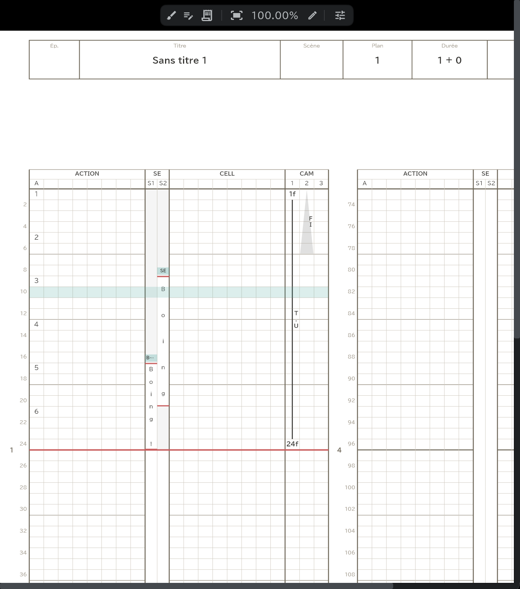
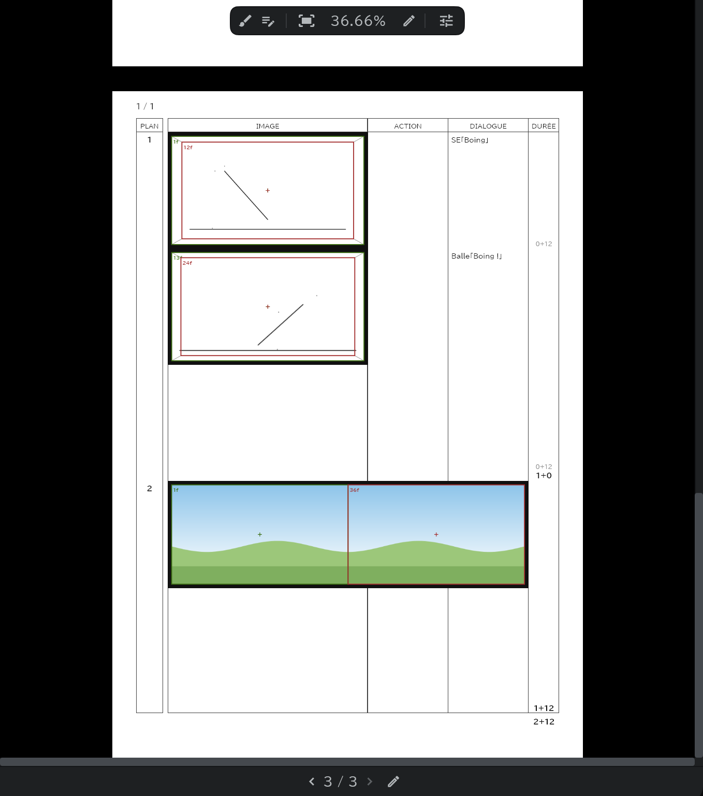

# Feuille de temps, feuille de conte, enveloppe de plan

Votre travail s'imprime sur les formulaires papier au fur et à mesure : vous travaillez en le voyant **exactement tel qu'il sera exporté**. Un bouton de la bande de droite contient les trois onglets (ouverts dès le départ).

## Pour les trois

- Tournez les pages avec la bande en bas du panneau (précédente · suivante, ou faites glisser le numéro de page).
- Activez le bouton pinceau en haut de la feuille (**Autoriser le pinceau**) et dessinez directement dessus, comme sur du papier. Les outils pinceau, gomme et forme dessinent ; avec tout autre outil, appuyer fait bouger la feuille.
- Faites glisser une image du [panneau Médias](/fr/media-pool) sur une case de la feuille et elle y entre comme photo. Avec Autoriser le pinceau activé, prenez une photo pour la déplacer et changer sa taille et sa rotation.
- Appuyez sur les champs titre, épisode, plan et nom de l'en-tête pour les modifier sur place. Le titre, l'épisode, le logo du studio, l'image de couverture et l'équipe de toute l'œuvre se règlent dans **Paramètres** (⚙) → **Réglages de l’œuvre**.
- Elle est [exportée](/fr/export) telle que vous la voyez.

## Feuille de temps

- Changez des dessins, des dialogues ou la caméra dans la timeline et la feuille s'écrit aussitôt. Les lignes dont l'[étiquette de couleur](/fr/layer-labels) est Intervalles vont dans la colonne CELL ; les autres lignes de dessin vont dans la colonne ACTION.
- La colonne SE reçoit les noms et dialogues des [SE](/fr/sound-layers) ; la colonne CAM reçoit les noms et mouvements des clés caméra (PAN · T.U · T.B) et les lignes de [direction](/fr/camera-section) et de [transition](/fr/camera-section).
- Les lignes qui vont sur la feuille se règlent avec la flèche de feuille de chaque ligne de calque. → [Les calques en bref](/fr/layers)
- Vous pouvez passer d'un affichage à l'autre : **Feuille de notation** (abrégée avec des mots comme répétition et maintien — *tome*, 止め) / **Feuille de données** (une case à la fois, exactement comme à l'export).

**Format de la feuille**

| Élément | Contenu |
|---|---|
| Longueur de feuille | 3 s / 6 s par feuille |
| Cases visibles | Lesquelles des cases d'en-tête Titre · Épisode · Scène · Plan · Durée · Animateur · Feuille s'affichent |
| Trait d'extension · ACTION / CELL | Oui / Non + N — quand le même dessin (*tome*) ou un × dure N commas ou plus, trace un trait à partir du (N+1)e comma |
| Plages sans dialogue | Grisées / Vides |

## Feuille de conte

- Un bloc du [calque storyboard](/fr/conte-layer) = une vignette de la feuille. Dessinez dans la zone image d'une vignette et cela devient le dessin de conte de ce plan.

**Format de la feuille de conte**

| Élément | Contenu |
|---|---|
| Modèle | Analogique / Numérique |
| Cadre noir des images | Oui / Non |
| Couverture · Page blanche | Incluse / Retirée |

## Enveloppe de plan

- Affiche l'enveloppe de chaque plan (informations du plan · équipe). L'équipe d'un plan se règle dans la pilule **Plan** → **Réglages du plan**.
- Choisissez le modèle dans **Format de l'enveloppe**.
