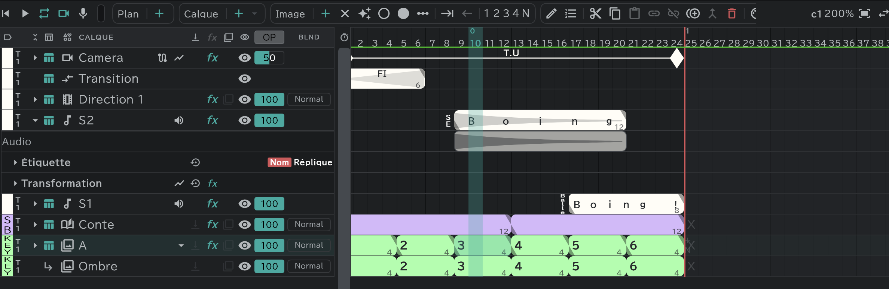
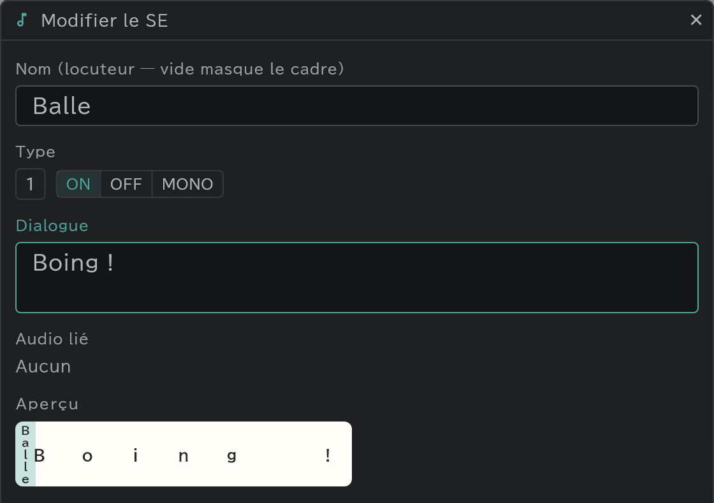

# Calques son (SE)

Le calque des bruitages et des dialogues. Calez-les sur les dessins grâce à leur forme d'onde ; les noms et les dialogues vont directement sur la [feuille de temps](/fr/sheets).

## Lignes SE

- La section **SE** de la timeline a deux lignes, **S1 · S2**, dès le départ. Pour en ajouter, utilisez **Calque ＋ ▾ → SE** (dans le panneau Conte, il suffit d'appuyer sur **＋** pour créer une ligne SE).
- Les lignes SE **appartiennent à toute la piste**. Un son qui s'étend sur plusieurs plans forme un seul bloc, et c'est la même ligne quel que soit le plan d'où on la regarde.

## Un bloc = un son

Créez un bloc (**Image ＋**) et ouvrez sa fenêtre avec **Modifier**  ou un double-clic.

| Élément | Contenu |
|---|---|
| Nom | Le nom du locuteur, etc. Laissez-le vide et le cadre d'étiquette sur le canevas est masqué |
| Type | **ON** (à l'écran) · **OFF** (hors écran) · **MONO** (monologue) |
| Dialogue | Le texte écrit dans la colonne SE de la feuille |
| Audio lié | Le fichier son que ce bloc joue |

## Apporter du son

- **Depuis un fichier** : déposez un fichier son sur la fenêtre, ou **Projet** → **Ouvrir un fichier** → dans la fenêtre d'import, réglez Vers sur **Ligne SE**.
- **Depuis le panneau Médias** : le menu de ce son → **Placer**. → [Panneau Médias et import](/fr/media-pool)
- **Enregistrement** : appuyez sur le **micro**  à côté du bouton de lecture pour enregistrer depuis la tête de lecture ; appuyez de nouveau pour arrêter, et la prise est placée en bloc SE. Une prise saturée parce que l'entrée était trop forte a un coin de bloc rouge. → [Lecture et enregistrement](/fr/playback)

## La forme d'onde et la piste audio

- La forme d'onde s'affiche toujours légèrement sur les blocs SE.
- Dans la piste **Audio**, ouverte avec **▸**, faites glisser le son dans le bloc pour le caler, ou faites glisser ses bords pour faire un fondu.

## Volume et coupure (Audio du calque)

Appuyez sur le bouton **haut-parleur** à côté du nom d'une ligne SE pour ouvrir le mixeur de cette ligne : **Muet · Solo · Gain · Panoramique**.

## Étiquettes

Le nom d'un bloc s'affiche aussi sur le canevas comme **Étiquette**. L'étiquette garde sa place dans le cadre caméra.

- Piste **Étiquette** : Taille · Interlettrage · Gras · Italique · Souligné · Barré · Encre du nom · Couleur de la boîte · Encre du dialogue · Afficher le dialogue.
- Les étiquettes prennent la **Transformation**, la fusion et les **Effets** comme un calque.

## Bon à savoir

- On ne dessine pas sur les lignes SE. Elles n'ont pas non plus d'écrêtage.
- Les lignes SE elles-mêmes ne peuvent pas être copiées et collées.
- Quand vous exportez une vidéo ou une séquence, choisissez **Intégrer le mixage SE dans la vidéo** sous **Audio** et le son est inclus. → [Export](/fr/export)
