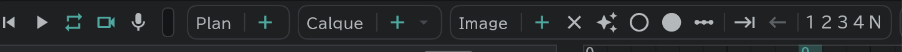

# Premiers pas

Pas à pas : ouvrir un nouveau projet, faire quelques dessins, les lire et enregistrer.

## 1. Un nouveau projet

- Au démarrage de l'application, un nouveau projet nommé **Sans titre 1** s'ouvre. Pour un autre nouveau projet, utilisez **Projet** (icône de dossier) en haut à gauche → **Nouveau projet**.
- Un nouveau projet contient déjà un plan, un calque de dessin **A** et un dessin dans sa première case : vous pouvez dessiner tout de suite.
- Le milieu de l'écran est le **Canevas**, le bas est la **Timeline**, et la bande verticale à gauche contient les **Outils**. Le nom de chaque partie est dans [Écran et panneaux](/fr/screen).

## 2. Dessiner

- Choisissez l'**Outil pinceau**  dans la bande d'outils à gauche et dessinez sur le canevas.
- Choisissez le type de pinceau dans le panneau **Bibliothèque d'outils** en haut à gauche (Base · Crayon · Plume · Aquarelle …). Plus d'infos dans [Pinceaux](/fr/brushes).
- Changez la **Taille** et l'**Opacité** du pinceau sur la pilule verticale au bord gauche du canevas. Faites glisser la barre ou appuyez sur ±, et tapez un nombre avec le bouton crayon à côté.
- La gomme est l'**Outil gomme** . Pour annuler, appuyez sur  ou sur la flèche en haut de la bande d'outils.
- Pour une couleur, appuyez sur le bouton de couleur au bord droit (deux cercles superposés) pour ouvrir le [panneau couleur](/fr/color) et choisissez-en une.

## 3. Faire le dessin suivant

Dans la timeline, une ligne = un calque, et l'horizontale = le temps (images). Un **bloc** coloré = un dessin.

- Sur la ligne du calque **A**, appuyez sur la case du nouveau dessin, puis sur le **＋** de **Image** en haut de la timeline : un nouveau dessin apparaît dans cette case.
- Avec **✦** (Création auto d'images) activé, il suffit de dessiner dans une case vide pour créer un dessin.
- Pour voir le dessin précédent en transparence pendant que vous dessinez, activez **Activer/désactiver la pelure d'oignon**  près du haut de la bande d'outils. → [Pelure d'oignon](/fr/onion-skin)
- Faites glisser l'extrémité d'un bloc pour changer la durée d'affichage de ce dessin (son nombre de commas).

## 4. Lecture

- Appuyez sur **▶** (lecture) en bas de la timeline pour lire, et appuyez de nouveau pour arrêter. Les boutons de boucle, de vue caméra et d'enregistrement sont là aussi. → [Lecture et enregistrement](/fr/playback)

## 5. Enregistrer

- Enregistrez avec **Projet** → **Enregistrer** . La première fois, vous choisissez un emplacement et un nom ; le projet est enregistré en un seul fichier `.anicel`.
- **La sauvegarde automatique est désactivée au départ.** Tant qu'elle est désactivée, le travail fermé sans enregistrer n'est pas gardé. Activez-la, et le fichier du projet lui-même est enregistré à l'intervalle choisi (3–60 minutes). → [Préférences](/fr/preferences) → **Sauvegarde auto**
- Pour le rouvrir, utilisez **Projet** → **Ouvrir un fichier** ou **Projets récents**. Déposer le fichier sur la fenêtre l'ouvre aussi. → [Ouvrir et enregistrer](/fr/files)

## Ensuite

- Les types de calques et leur usage : [Les calques en bref](/fr/layers)
- Aligner les plans et construire le conte : [Panneau Conte](/fr/storyboard)
- Exporter des vidéos et des cellulos : [Export](/fr/export)
