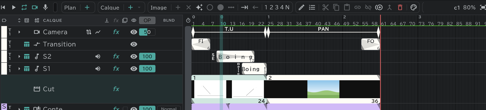

# Panneau Conte

Le panneau qui **aligne les plans** de toute l'œuvre. Si la timeline est l'intérieur d'un plan, le panneau Conte est l'extérieur qui relie les plans entre eux. Il lit les plans à la suite même quand leurs tailles diffèrent. On y passe avec les onglets en bas du panneau timeline.

## Les lignes du panneau Conte

| Ligne | Contenu |
|---|---|
| **Camera** (la ligne caméra) | Les clés et les mouvements caméra de chaque plan (PAN · T.U · T.B) |
| **Transition** (la ligne transition) | Les changements de scène comme FI · FO · O.L |
| **Piste vidéo** | Un bloc = **un plan** |
| **Conte** (le storyboard) | Le [calque storyboard](/fr/conte-layer) de chaque plan. Une case = une vignette de la [feuille de conte](/fr/sheets) |
| **S1 · S2 …** | [SE](/fr/sound-layers) — un son qui s'étend sur plusieurs plans forme aussi un seul bloc |

## Travailler les plans

- Sur la ligne **Piste vidéo**, sélectionnez des plans, faites-les glisser pour changer l'ordre, et faites glisser leurs bouts pour changer leur durée.
- Un nouveau plan, c'est le **＋** de la pilule **Plan** ; dupliquer et supprimer, c'est **Dupliquer** · **Supprimer** dans la pilule commune.
- Double-cliquez sur un plan (ou utilisez **Modifier**) pour le renommer.
- Les [plans liés](/fr/linked-cuts) ont 🔗 à côté du nom du plan.

## Dessiner le conte

- Sur la ligne **Conte**, créez avec **＋** un calque storyboard pour un plan qui n'en a pas.
- Sélectionnez des vignettes et changez leur durée ; double-cliquez sur un bloc pour renommer la vignette. Une vignette encore sans dessin s'affiche en pâle.
- Dessinez sur le canevas ou dans le panneau [Feuille de conte](/fr/sheets).

## O.L (fondu enchaîné)

- O.L s'étend sur deux plans : on le modifie donc ici, sur la ligne **Transition**, et non dans la timeline. Réglez le type avec **Modifier** et la durée en faisant glisser le bout du bloc.
- Pendant un O.L, la ligne caméra s'affiche coupée en deux, pour le plan d'avant et le plan d'après.

## Lecture

Appuyez sur **▶** dans le panneau Conte pour lire **tous les plans à la suite** (dans la timeline, seulement le plan courant). → [Lecture et enregistrement](/fr/playback)

## Bon à savoir

- Il y a une seule piste vidéo.
- Faites glisser les lignes dans l'en-tête pour changer leur ordre (l'ordre de la section CAM est fixe).
- Les menus solo et d'affichage sont les mêmes que dans la timeline. → [Les calques en bref](/fr/layers)
