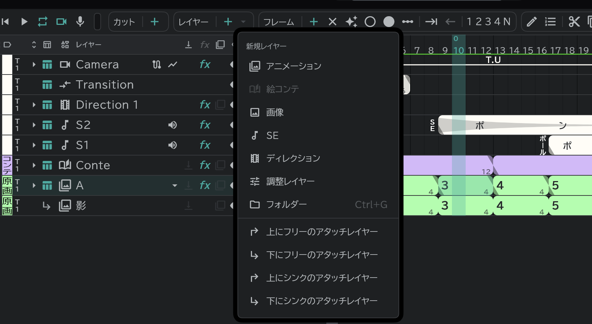

# アタッチレイヤー

本体のレイヤーにくっついて移動・効果をいっしょにたどり、絵だけを別に持つレイヤーです。影やハイライトに使います。

- 本体のレイヤーを選び、**レイヤー ＋ ▾** から上/下の **シンク**・**フリー** のアタッチレイヤーを選びます。レイヤーをほかのレイヤーの上にドラッグ&ドロップしても、くっつきます。
- **シンク**:本体のタイミングをそのままたどります。
- **フリー**:タイミングは別に決めます。
- 外すときは **レイヤー** → **アタッチを解除** です。
- 新しいアタッチレイヤーの番号は、その本体にくっついたものどうしで数えます。
