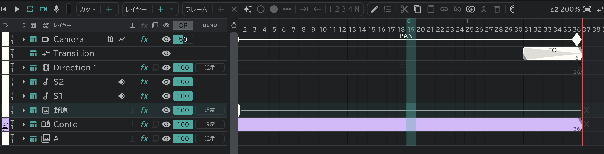

# カメラ・ディレクション・トランジション

タイムラインのいちばん上の **CAM** セクションで、カメラワークと画面転換を扱います。上から **カメラ・トランジション・ディレクション** の順に固定です。3つとも[タイムシート](/ja/sheets)の CAM 欄にそのまま記入されます。

## カメラ

カットごとにひとつずつ最初からある行です(名前は **Camera**)。カメラの行を選ぶと、カンバスがカメラを動かす状態になります。

### 動かす

- キーでカメラの **位置・スケール**(拡大)**・回転** を決めます。行を開くと、3つが別々のレーンになります。カンバス・再生・書き出しがそのまま動きます。
- カンバスでカメラフレームを直接ドラッグして動かしたり回したりしても、そのフレームにキーができます。
- キーはそのカットのフレームの中にだけ置かれます。カットの長さを変えると、最後のキーが終わりについていきます。
- キーの速さ(イン・アウト:リニア・イーズ・クイック・スムーズ・ホールド)と **影響**、位置キーの **パス**(リニア・ベジェ・連続ベジェ・自動ベジェ)と **ロービング** は、キーの編集画面で決めます。→ [エフェクトとトランスフォーム](/ja/effects?id=キーの編集画面)
- ベジェのパスは、カンバスでハンドルを使って曲げます。
- カメラの行の **グラフ** ボタンで、**値・速度** のグラフを見ます。

### 自動で書かれる指示

キーとキーの間でカメラが大きくなると **T.U**、小さくなると **T.B**、それ以外に動いたり回ったりすると **PAN** がカメラの行に書かれ、タイムシートにも記入されます。動かない区間には書かれません。

### カメラビューとカメラパス

- カメラの行の **目** = カメラビュー(再生ボタンの横の **カメラビュー** と同じ)。オンにするとカメラフレームの外が隠れ、横の **不透明度** が隠す暗さです。
- 名前の端の **カメラパス** ボタンで、カメラが通る道をカンバスに描きます。

| 項目 | 内容 |
|---|---|
| 表示 | オフ・**空間**(通る道)・**空間＋時間**(道の上にフレームごとの点) |
| 範囲 | **全キー**・**再生ヘッド周辺** |
| 点の間隔 | 点を何フレームごとに打つか |
| 前後 | 再生ヘッド周辺のとき、前後何フレームまで |

- カメラの行の **FX** の欄をオフにすると、書き出し・再生でカメラワークを飛ばします(カメラフレームはそのまま)。
- カメラフレームのサイズは、**設定**(⚙) → **プロジェクト設定** → **カメラ** で決めます(プロジェクト全体で共通)。→ [プロジェクト設定](/ja/settings)

## トランジション

**トラックにひとつ** ある行です(名前は **Transition**)。カットとカットの間の画面転換を入れます。

| 記号 | 意味 |
|---|---|
| FI・FO | 黒い画面から明るくなる・黒い画面へ暗くなる |
| WI・WO | 白い画面から・白い画面へ |
| O.L | 前のカットと重なって切り替わる(オーバーラップ) |

- 種類は **編集**で、長さはブロックの端をドラッグして変えます。カンバス・再生・書き出しにそのまま表示されます。
- トランジションの行の **目** は、フェードを再生するかどうかです。名前を変えたり、消したり、動かしたりはできません。
- O.L はふたつのカットにまたがるので、[コンテパネル](/ja/storyboard)で編集します。

## ディレクション

**PAN・FIX・T.U** のようなカメラの指示をブロックで書く行です(名前は **Direction 1** …、カットごとにひとつ以上)。シートに書く表記なので、画面は動かしません。

- ブロックを作って **編集** で **新規指示 / 指示の編集** の画面を開きます。

| 項目 | 内容 |
|---|---|
| 指示（記号） | FIX・PAN・PAN UP・PAN DOWN・SL・Follow・T.U・T.B・Q T.U・Q T.B … |
| 名前 | 空欄なら記号名 |
| 始点名（A）・終点名（B） | シートの A ⊢──⊣ B に書かれる値(例:PAN の始点・終点の位置) |

- **指示記号を編集** で、記号を追加したり直したりします(名前・アイコン・色・表示の形)。
- ディレクションの行にも絵を描けます。オニオンスキンも使えます。
- ディレクションの行どうしは順番を変えられます。[兼用カット](/ja/linked-cuts)にはつながりません。
