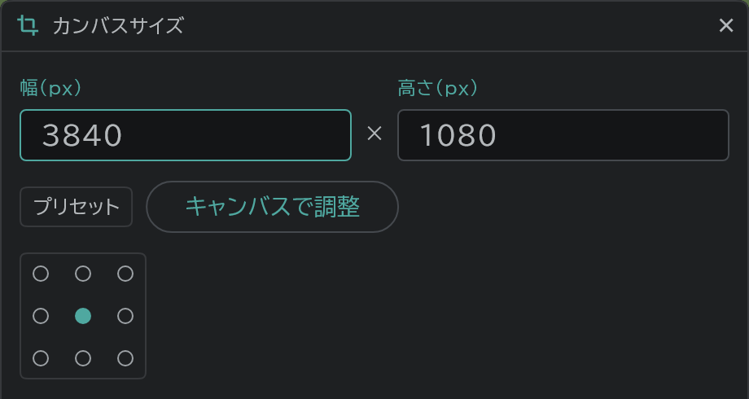

# カットごとのカンバスサイズ

カットごとにカンバスサイズを別々に決められます。長い PAN の背景が必要なカットだけを広くする、といった使い方です。

- タイムライン上部の **カット** を押し → **カンバスサイズ** を開きます。いまのカットに適用され、[兼用カット](/ja/linked-cuts)なら、つながったカットもいっしょに変わります。
- **プリセット**(A4 150・200・300dpi、HD・FHD・2K・4K)から選ぶか、幅と高さを入力し、3×3 のマスで既存の絵を固定する位置を選びます。
- **キャンバスで調整** を押すと画面が閉じ、カンバスの縁をドラッグしてサイズを変えます。ドラッグする反対側の縁が固定され、チェックか Enter で確定します。
- カメラは絵といっしょに動くので、サイズを変えても画面に収まる絵はそのままです。
