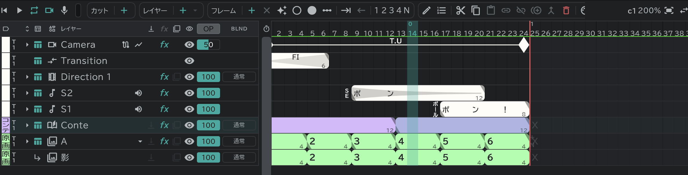

# 絵コンテレイヤー

カットのコンテを描くレイヤーです。**カットごとにひとつ** 置きます(名前は **Conte**、カラーラベルは **コンテ上がり** で始まります)。

## 作る

- タイムラインの **レイヤー ＋ ▾ → 絵コンテ**。
- [コンテパネル](/ja/storyboard)の **Conte** 行で、絵コンテレイヤーのないカットの区間の **＋**。
- すでに描いたアニメーションレイヤーを絵コンテレイヤーに:そのレイヤーを選んで **レイヤー** のピルのメニュー → **絵コンテレイヤー** にチェック。チェックを外すと、またアニメーションレイヤーになります(絵コンテになると空きコマは埋められます)。
- カットにすでに絵コンテレイヤーがあると、もうひとつは作れません。

## コマを分ける

- **ブロックひとつが[コンテ用紙](/ja/sheets)の1コマ** です。
- 空きコマがありません。ブロックは次のブロックかカットの終わりまで続きます。そのため、×(空にする)・ホールド・リピートはありません。
- ブロックの中で **フレーム ＋** を押すと、その位置でコマが分かれます。ブロックの境目をドラッグすると、前後のコマが長さをやりとりします。
- カンバスで描くか、[コンテ用紙](/ja/sheets)パネルに直接描きます。

## トラック全体で共有するもの

同じトラックのカットは、絵コンテレイヤーの **名前・カラーラベル・不透明度・合成モード・エフェクトの構成・アタッチの構成** を共有します。あるカットで変えると、すべてのカットが変わります。コマと絵はカットごとに別々です。

## コンテに付けるレイヤー

絵コンテレイヤーにも[アタッチレイヤー](/ja/attach-layers)を付けられます。コンテのアタッチは外せません。

## 書き出し

- [書き出し](/ja/export) → **コンテ用紙** で、PDF(ベクター)・PNG・JPG に出します。
- コンテをそのまま動画として見るには、[コンテパネル](/ja/storyboard)で再生するか、連番で書き出します。
