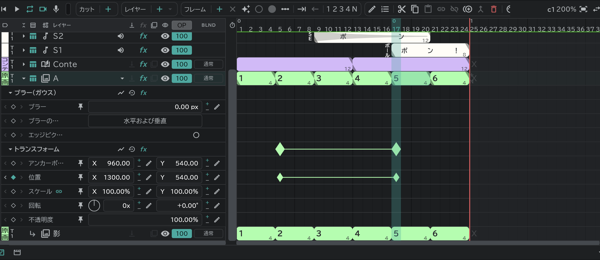
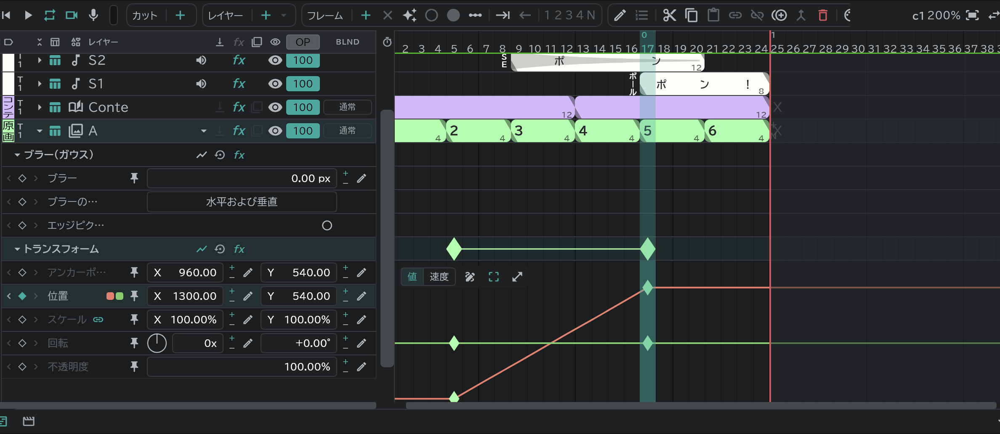

# エフェクトとトランスフォーム

レイヤーの行の **▸** を押すと、そのレイヤーの **レーン** が開きます。レーンひとつが値ひとつで、レーンに **キー**(◆)を置くと、その値が時間に合わせて変わります。

## トランスフォーム

アニメーション・絵コンテ・画像・フォルダー・SE のレイヤーにあります。

- **回転** は回転数と角度の二つの欄(450° = **1x**・**+90.00°**)。前のダイヤルを円を描くようにドラッグしても回せます。
- 見出し行の右:**グラフ**・**リセット**(値を最初に戻す、キーは残る)・**fx**(バイパス / 適用)。
- 変形ツールでそのレイヤーをつかむと、カンバスで手で位置・サイズ・回転を変えられます。

## エフェクト

レイヤーを選んで、タイムラインの **Fx** ボタンから追加します。[コンテパネル](/ja/storyboard)の絵コンテの行(とそのアタッチの行)でも同じボタンで追加できます — 絵コンテの行に入れると、そのトラックの絵コンテがあるすべてのカットにできます。

| エフェクト | 値 |
|---|---|
| **輝度＆コントラスト** | 輝度・コントラスト(−100〜100) |
| **色相/彩度** | マスターの色相(−180〜180°)・マスターの彩度・マスターの明度 |
| **ブラー（ガウス）** | ブラー・ブラーの方向(水平および垂直 / 水平 / 垂直)・**エッジピクセルを繰り返す**(オンにするとキャンバスの端が透けず、うまったまま) |
| **ブラー（放射状）** | 適用量・種類(**回転** / **ズーム**)・中心(カンバスの十字をドラッグ)・アンチエイリアス(最高 / ドラフト) |
| **ブラー（方向）** | 方向(角度)・ブラーの長さ |
| **ブラー（カメラレンズ）** | ブラーの半径(0〜500)・シェイプ(三角形 〜 十角形、最初は四角形)・真円率・縦横比・回転・回折フリンジ(縁だけ明るい輪)・エッジピクセルを繰り返す |
| **カラーキー** | キー操作(**キーカラー**:選んだ色を消す / **カラー維持**:直前のキーが消したもののうち、選んだ色を戻す)・キー色・許容値・適用量 |
| **セル番号** | 絵にセル番号(A1 …)を入れる・位置・スケール・色(アニメーション・絵コンテ・画像のみ) |

- 上から順にかかります。順番は自由に変えられます。
- レイヤーの行の **fx** の欄は、そのレイヤーのエフェクト全体をまとめてバイパス / 適用します。
- 消すには、そのエフェクトの見出し行を選んで **削除**。
- 下のレイヤー全体にかけるには[調整レイヤー](/ja/adjustment-layers)。
- カメラ・トランジションの行にはありません。[アタッチレイヤー](/ja/attach-layers)は本体のレイヤーのトランスフォーム・エフェクトに従います(絵コンテレイヤーに付いたアタッチは自分のもの)。
- [書き出し](/ja/export)の **レイヤーFX**:FXオン / 基本のみ / FXオフ。

## キーを作る

- 再生ヘッドを置いたフレームでレーンの **◆** を押すと、その位置の値でキーができます(もう一度押すと消える)。
- キーのあるレーンでは、値をドラッグしても、鉛筆ボタンで数値を入力しても、カンバスでハンドルをドラッグしても、そのフレームにキーができます。
- レーンのコマを選んで **フレーム ＋** でも作れます。
- キーをドラッグすると時間が動きます。コピー・貼り付け・削除は絵のブロックと同じです。

## キーの編集画面

キーを選んで **編集**を押すか、キーをダブルクリックします。

| 項目 | |
|---|---|
| 名前 | 兼用カットどうしで共有 |
| イン・アウト | 前のキーから入る・次のキーへ出る速さ。**ホールド** は次のキーまで値をそのまま |
| 影響 | その速さの変化が区間のどれだけにかかるか |
| パス・ロービング (位置キー) | キーの間を通る道・キーの時間を手放して均一な速さで(最初・最後のキーを除く) |

キーのマークの形が、選んだ速さに合わせて変わります。

## グラフ

見出し行やレーンの **グラフ** ボタンで、レーンの下に開きます。

- **値 / 速度**:値のカーブと速さのカーブを切り替えて見ます。
- キーをドラッグして値・時間を動かし、ハンドルで緩急を調整します。
- **ペン**(オンにするとカーブを押してキーを足す — オフでも <kbd class="k-pc">Ctrl</kbd><kbd class="k-mac">⌘</kbd>+クリック)・**変形ボックス**(選んだキーをボックスで動かしたり伸ばしたり)・**拡大表示**。
- 空いたところをドラッグすると、ボックスの中のキーが選ばれます。
- **すべてのグラフに表示**:ほかのグラフを見ているときも、そのレーンをずっと重ねて表示します。
