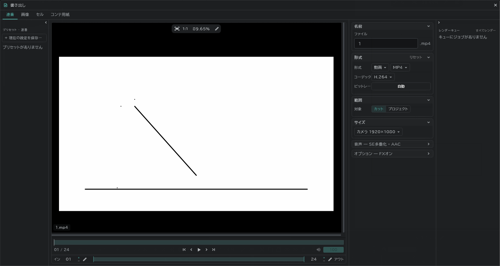
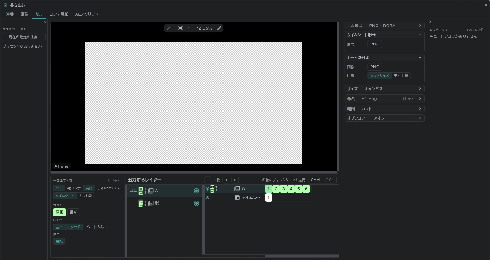

# 書き出し

左上の **プロジェクト**(フォルダ) → **書き出し…** から、ひとつの画面で書き出します。

- タブ:**連番**(動画・連番画像) · **画像** · **セル** · **コンテ用紙**
- 範囲(カット/プロジェクト)とサイズ(カメラ/キャンバス)は、タブに応じて選びます。
- 動画は **コーデック** を選びます(MP4:H.264・H.265、MOV:H.264・ProRes)。この機器で使えないコーデックは、オフのまま表示されます。
- 動画には SE の行の音もいっしょに入ります(**音声** でオフにできます)。ミュートした SE の行は入りません。
- ファイル名は設定のいちばん上の **名前** に入れ、保存先は **書き出し** を押すときに選びます。
- 書き出しのあいだは画面の設定がロックされ、**キャンセル** だけを押せます。
- いまのフレーム一枚だけを画像で残すときは、**プロジェクト** → **名前を付けて保存** → **PNG…**・**JPG…** を使います。

## セル

絵一枚をファイル一枚(PNG・JPG)で書き出します。タイムシートとカット袋もここで書き出します。

- **書き出す種類** で、セル・絵コンテ・美術・ディレクション、タイムシート・カット袋から書き出すものを選びます。タイムシートは PNG・JPG・XDTS で書き出します。
- プレビューの下のリストで、行ごと、絵ごとにオン/オフします。
- リストの上の帯で、絵にディレクション・カメラパス・ガイドを重ねて書き出します。
- ファイル名はレイヤー名と絵の番号です(例:`A1.png`)。フォルダ・接頭辞・桁数・接尾辞は **命名** で選びます。
- [アタッチレイヤー](/ja/attach-layers)は、本体と重ねた一枚で出ます。
- [カラーラベル](/ja/layer-labels)とテイクで選び出します(例:原画の最新テイクだけ)。
- [兼用カット](/ja/linked-cuts)はひとつのカットとして扱います。タイムシートは、つながったカットごとに出ます。
