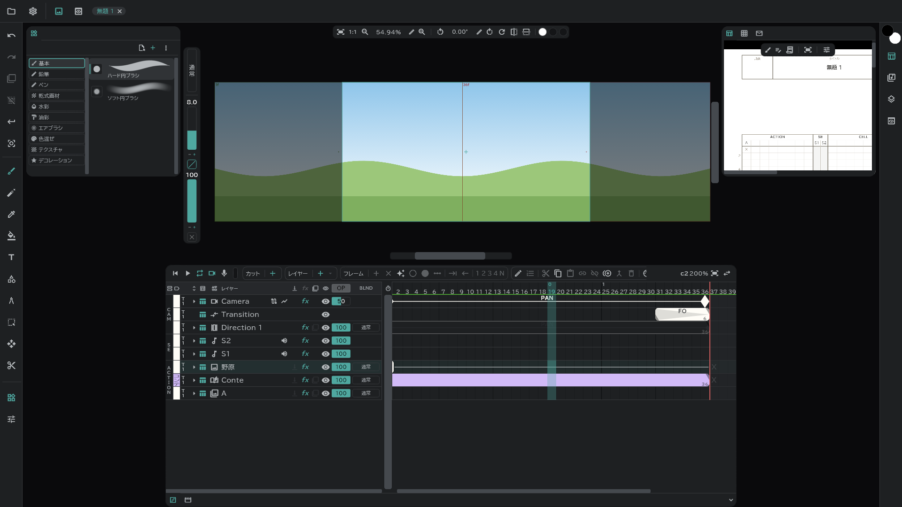

# 画像レイヤー

背景(BG)・BOOK のような **絵1枚をカット全体に** 敷くレイヤーです。名前は **BG**、すでに BG があれば **BOOK** で作られ、カラーラベルは **美術上がり** で始まります。

## 作る

- **レイヤー ＋ ▾ → 画像**:空の画像レイヤー。その上に直接描きます。
- **ファイルから**:画像ファイルをウィンドウにドラッグ&ドロップするか、**プロジェクト** → **ファイルを開く** で選ぶと **インポート** 画面が開きます。行ごとに **配置先**(新規レイヤー・新規カット・メディア …)を決めて **インポート** を押します。→ [メディアパネルとインポート](/ja/media-pool)
- **メディアパネルから**:メディアのメニュー → **配置**。

## ファイルのまま vs ラスタライズ

インポートするときに **ラスタライズ** を選びます。

| | ラスタライズ オフ(参照) | ラスタライズ オン |
|---|---|---|
| レイヤーに入るもの | ファイルを **指す** 絵 — 元の解像度のまま | カンバスのピクセルに **焼き込んだ** 絵 |
| その上に描く | できない | できる |
| 置く場所 | レーンのいちばん上の **参照**(位置・スケール・回転) | 普通の絵と同じ |
| メディアパネル | 残る | 残らない |

- 参照の画像レイヤーは、名前の横にファイルのボタンが付きます。押すと **ラスタライズ** できます(あとから焼き込んでもかまいません)。
- 変形ツールで参照レイヤーをつかむと、カンバスにボックスが出て、手で動かせます。

## 番号の続いた画像・PSD・動画

- `A1.png`・`A2.png` のように番号の続いたファイルは、ひとつ選ぶだけで全部入ります。動画のように **ひとつの参照レイヤーが時間に合わせて変わりながら** 表示され、範囲はプレビューの IN/OUT で選びます。ラスタライズすると、1枚ごとに絵になります。
- PSD は **レイヤーを保持**(レイヤー・フォルダーをそのまま)か **レイヤーを統合**(1枚に)を選びます。
- 動画は **絵 + 音 / 絵のみ / 音のみ** を選びます。

## 知っておくこと

- 画像レイヤーは、カット全体を絵ひとつが覆います。絵を空にはできますが、コマを分けることはしません。
- オニオンスキンはありません。クリッピング・合成モード・エフェクト・トランスフォームはできます。
- [兼用カット](/ja/linked-cuts)どうしでは、**同じ名前** の画像レイヤーがつながります。
