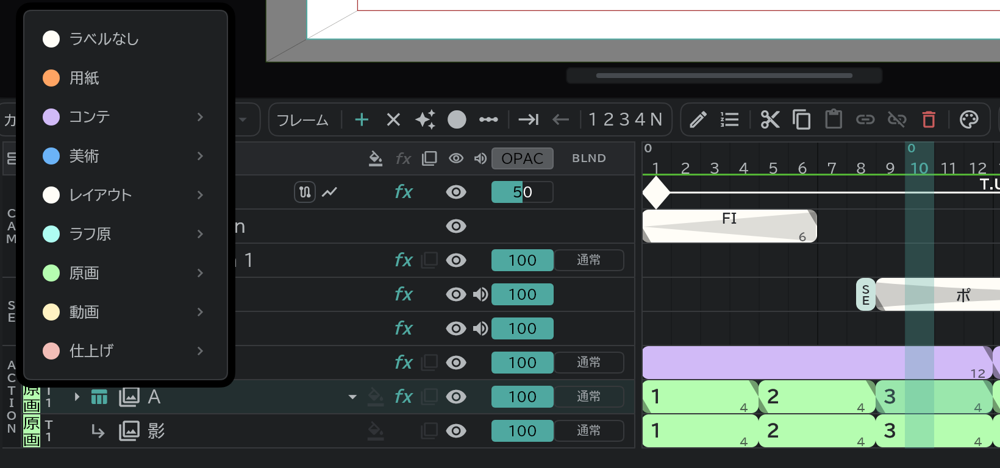

# カラーラベル

レイヤーごとに工程(コンテ・レイアウト・原画・動画など)を付けると、行とフレームのブロックにその色が塗られます。

- 行のいちばん左のラベル欄を押して工程を選びます。**▸** からは上がりや、演出・作画監督などの修正段階を選びます。
- ラベルの右の欄はテイク(1〜9)です。[書き出し](/ja/export)で最新のテイクだけを選び出すときに使います。
- カットにもラベルを付けられます(タイムライン上部の **カット** → **レイヤーマーク**)。
- どの段階の絵か、タイムラインでひと目でわかります。動画ラベルの行は[タイムシート](/ja/sheets)の CELL 欄に記入されます。
