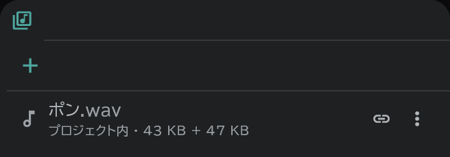

# メディアパネルとインポート

**メディアパネル**(メディアプール)は、プロジェクトに取り込んだ画像・音・映像・PDF を集めておく場所で、**インポート画面** は、ファイルを取り込むときにどこにどう入れるかを決める画面です。

## インポート画面

ファイルをウィンドウにドラッグ&ドロップするか、**プロジェクト** → **ファイルを開く** / **フォルダを開く**、またはメディアパネルの **＋**(インポート)で開きます。

- いちばん上の行:選んだフォルダーを **カット**(フォルダー全体をカットひとつに)として入れるか、**カスタム**(行ごとに配置先を別々に)で入れるか、新しいカットを作るときの **カット名**。
- ファイルひとつが1行です。列:名前・更新日時・サイズ・解像度、それに行ごとに決めるもの:

| 列 | 選ぶもの |
|---|---|
| **配置先** | 新規レイヤー・新規カット・SE行・メディア(パネルに登録だけ)・除外・「行 · nコマ目」(すでにある行のそのコマ) |
| **ラスタライズ** | オン(カンバスの絵として焼き込む) / オフ(ファイルを指す[参照の画像](/ja/image-layers)) |
| **ファイル** | **埋め込み**(プロジェクトファイルの中に入れる) / **リンク**(外のファイルを指す) |
| **フィット** | 原寸・比率を保って伸ばす・比率を無視して伸ばす |
| **オプション** | PSD:レイヤーを保持 / レイヤーを統合・動画:絵 + 音 / 絵のみ / 音のみ・連番画像:範囲 |

- 右のプレビューで、動画・連番画像の **IN / OUT**(使う範囲)を決めます。
- 問題があると、下に **警告 n 件** が出ます(例:PSD のロックのように、取り込めなかったもの)。
- 動画のフレームレートがプロジェクトと違うときは、プロジェクトを動画に合わせるかをたずねます(音のタイミングは維持)。
- 画像の入った **カットフォルダー** を開くと、フォルダーの構造どおりにカット・レイヤーが作られます。画像が1枚の行は画像レイヤー、複数枚ならアニメーションレイヤーに決まり、行の種類の欄で変えられます。

## メディアパネル

画面右のバーの **メディア** ボタンで開きます。

- 行ごとに **プロジェクト内 / リンク** の表示と、そのメディアの **使用箇所**(押すとその場所へ)が見えます。
- **配置**:行の **⋮ → 配置**、または行をドラッグしてタイムライン・カンバス・[コンテパネル](/ja/storyboard)・ビューアに置きます。画像を[タイムシート・コンテ用紙](/ja/sheets)のコマに置くと、写真として入ります。
- **⋮** メニュー:ビューアで開く・サブビューアで開く・配置・名前を変更・再リンク・プロジェクトファイルに取り込む・WAVで書き出す(音)・メディアを削除。
- 使用中のメディアを消すと、配置したものもいっしょに消えることを先にたずねます。

## リンクしたファイルが見つからないとき

リンクにした元のファイルが移動・削除されると、パネルの上に **見つからないファイル n 個** が出ます。

- **フォルダーから探す**:ファイルの移った先のフォルダーを選ぶと、その中を探していくつ見つかったかを知らせ、再リンクするかをたずねます。
- ひとつずつなら、行の **⋮ → 再リンク**。
- 別の機器に移すプロジェクトは、**プロジェクトファイルに取り込む** で元のファイルを入れておくと安全です。

## ビューアに書き込む

ビューア上部の **ブラシを許可** をオンにすると、埋め込んだ画像・動画・PDF のページの上に直接書き込めます。
