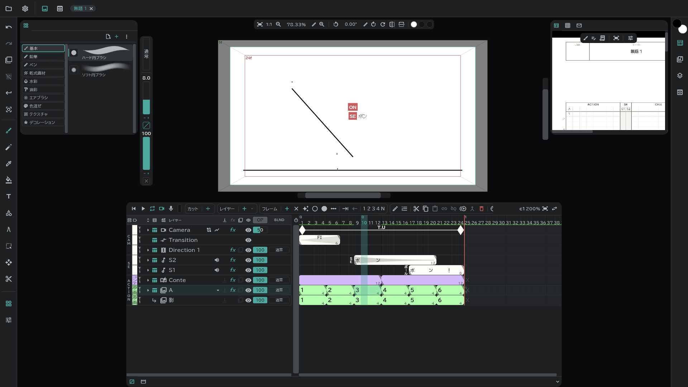
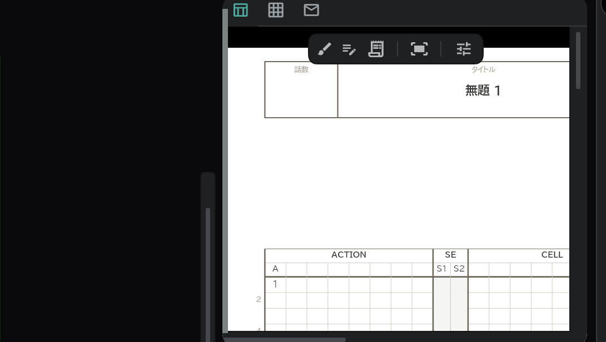
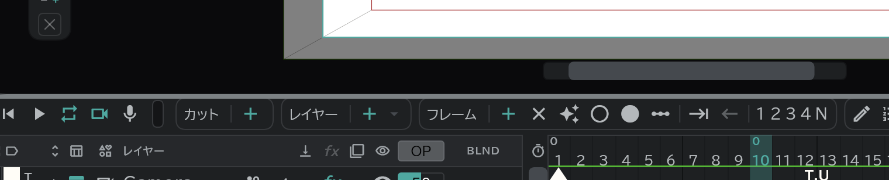

# 画面とパネル

## 画面の5つの部分

| 場所 | あるもの |
|---|---|
| **上部のバー** | **プロジェクト**(フォルダーのアイコン)メニュー・**設定**(⚙)メニュー・カンバス/ビューアの切り替え・開いているプロジェクトのタブ |
| **左の縦のバー** | 元に戻す・やり直す・オニオンスキン・選択解除・確定・ソロのボタン、その下に[ツール](/ja/tools) |
| **左右のバー** | パネルのボタン。押すとそのパネルがカンバスの横に開きます |
| **中央** | **カンバス**(描く場所)または **ビューア**(動画・画像ファイルを見る場所) |
| **下部** | **タイムライン** パネルと **コンテ** パネル |

## パネルを開く・閉じる

- 左右のバーのボタンひとつが **パネルグループ** ひとつです。押すと開き、もう一度押すと閉じます。複数のグループを同時に開けて、開いたグループは上から下へ積み重なります。
- ボタンにマウスを乗せると、そのグループに入っているパネルの名前が表示されます。
- 最初にインストールしたときに開いているのは、左の **ツールライブラリ** と右の **タイムシート・コンテ用紙・カット袋** です。
- パネルを画面から完全に外したり、また入れたりするには、**設定**(⚙) → **パネル** でチェックします。

最初の配置は次のとおりです。

| ボタン | 場所 | パネル |
|---|---|---|
|  | 左 1 | [ツールライブラリ](/ja/tools) |
|  | 左 2 | [ツール設定](/ja/tools) |
|  | 右 1 | [カラーホイール・RGB・パレット](/ja/color) |
|  | 右 2 | [タイムシート・コンテ用紙・カット袋](/ja/sheets) |
|  | 右 3 | [メディア](/ja/media-pool) |
|  | 右 4 | [オニオンスキン](/ja/onion-skin)・ツールサイズ |
|  | 右 5 | サブビューア |
|  | 中央 | カンバス・ビューア |
|  | 下 | [タイムライン](/ja/timeline)・[コンテ](/ja/storyboard) |

## パネルを動かす

- パネル上部の **タブ**(アイコン)をドラッグして別のグループのタブの列に置くと、そのグループへ移ります。同じ列の中でドラッグすると順番が変わります。
- タブを左右のバーの **＋**(新しいパネルグループ)の欄に置くと、そのパネルだけが入った新しいグループができます。ひとつのバーに置けるグループは8つまでです。
- タブが列に収まりきらないと、末尾に **+N** が付きます。押すと残りが見えます。
- カンバスのタブは固定されていて動かせません。
- 配置を最初の状態に戻すには、**設定**(⚙) → **パネル** → **ワークスペース配置をリセット** です。

## 大きさを変える

- 開いたパネルのカンバス側の縁をドラッグすると幅が、パネルどうしの境目をドラッグすると高さが変わります。角をドラッグすると両方が変わります。

- 下部のタイムライン・コンテの領域も、上の縁をドラッグして高さを変えます。タブの列の端の **折りたたむ** を押すと低く畳まれ、**広げる** で元に戻ります(ショートカット **タイムライン領域を畳む / 開く**)。

## 中央:カンバスとビューア

- 上部のバーの **カンバス / ビューア** の切り替えで、中央に何を置くかを選びます。別のパネルを中央にドラッグして置いた場合は、そのパネルもここに出ます。
- **ビューア** は、動画・画像ファイルを絵とは別に表示して見る場所です(参考映像など)。**サブビューア** は同じことを横のパネルで行います。ファイルはビューアにドラッグ&ドロップするか、[メディアパネル](/ja/media-pool)の **ビューアで開く** で開きます。

## 配置を変える (設定 → パネル)

| 項目 | すること |
|---|---|
| **ツールバーを右端に** | ツールバーをカンバスの右側に移します |
| **タイムライン領域を上に** | タイムライン・コンテの領域を画面の上部に置きます |
| **ブラシの値を上部のバーに** | カンバスの左にあるブラシのサイズ・不透明度のピルを上部のバーに移します |
| **全画面表示** | (デスクトップ)ウィンドウを画面全体で使います |
| **ワークスペース配置をリセット** | パネルの配置を最初の状態に |

## プロジェクトのタブ

- プロジェクトを複数開くと、上部のバーにタブとして並びます。タブを押して切り替え、**✕** で閉じます。

## メニューの一覧

**プロジェクト**(フォルダーのアイコン)

新規プロジェクト・ファイルを開く…・フォルダを開く・保存・名前を付けて保存・最近使ったプロジェクト・書き出し → [開く・保存](/ja/files)・[書き出し](/ja/export)

**設定**(⚙)

| 項目 | 内容 |
|---|---|
| 作品設定 | タイトル・話数・会社ロゴ・表紙の絵・スタッフ → [タイムシート・コンテ用紙・カット袋](/ja/sheets) |
| プロジェクト設定 | FPS・サンプルレート・カメラサイズ・再生方式 → [プロジェクト設定](/ja/settings) |
| キーボードショートカット | → [ショートカット](/ja/shortcuts) |
| 環境設定 | 入力・自動保存・オーディオ・言語・表示・メモリ → [環境設定](/ja/preferences) |
| パネル | 上のパネル一覧と配置 |
| Anicel について | バージョン |
| フィードバックを送る | 文章だけ、またはスクリーンショット・動画を添えて送る — 端末とビルドの情報はあらかじめ入る |
