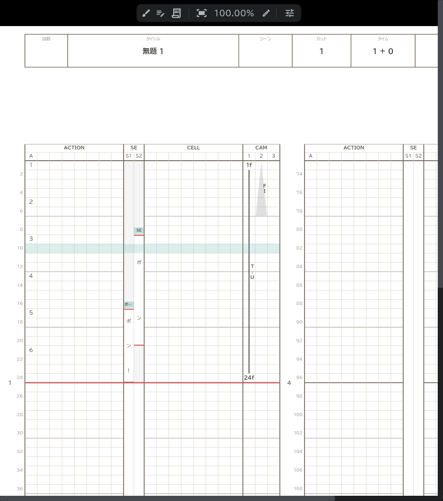
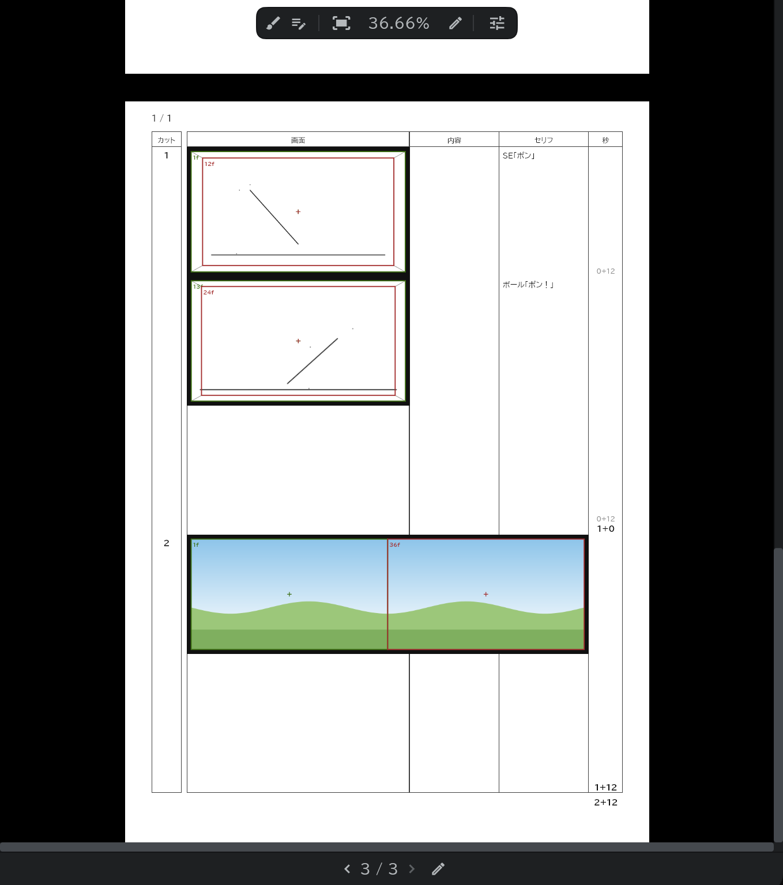

# タイムシート・コンテ用紙・カット袋

作業した内容がすぐに紙の書式に記入されるので、**出力されるそのままの姿** を見ながら作業します。右のバーの同じボタンひとつに、3つのタブが入っています(最初から開いています)。

## 共通

- ページはパネル下の帯でめくります(前のページ・次のページ、またはページの数字をドラッグ)。
- 用紙上部の筆のボタン(**ブラシを許可**)をオンにすると、紙のように直接描けます。ブラシ・消しゴム・図形ツールで描き、ほかのツールで押すと用紙が動きます。
- [メディアパネル](/ja/media-pool)の画像を用紙のコマにドラッグ&ドロップすると、写真として入ります。ブラシを許可がオンなら、写真をつかんで動かし、サイズ・回転を変えます。
- 頭のタイトル・話数・カット・作画者の欄は、押してその場で直します。作品全体のタイトル・話数・会社ロゴ・表紙の絵・スタッフは、**設定**(⚙) → **作品設定** で決めます。
- 見えているとおりに[書き出し](/ja/export)されます。

## タイムシート

- タイムラインで絵・セリフ・カメラを変えると、その場でシートに記入されます。[カラーラベル](/ja/layer-labels)が動画の行は CELL 欄に、ほかの絵の行は ACTION 欄に記入されます。
- SE 欄には[SE](/ja/sound-layers)の名前・セリフが、CAM 欄にはカメラのキー名と動き(PAN・T.U・T.B)と[ディレクション](/ja/camera-section)・[トランジション](/ja/camera-section)が記入されます。
- シートにどの行を載せるかは、レイヤーの行のシートの矢印で決めます。→ [レイヤーの概要](/ja/layers)
- 表示を2通りに切り替えられます:**表記シート**(リピート・止めのような文字で短く書く) / **データシート**(書き出すとおりに1コマずつ)。

**シート書式**

| 項目 | 内容 |
|---|---|
| シートの長さ | 1枚に 3秒 / 6秒 |
| 表示する枠 | 頭のタイトル・話数・シーン・カット・タイム・作画者・シートの枠のうち、表示するもの |
| 引き伸ばし線・ACTION / 引き伸ばし線・CELL | あり / なし + N — N コマ以上同じ絵(止め)か × が続くと、(N+1) コマ目から線を引く |
| セリフのない区間 | 塗る / 塗らない |

## コンテ用紙

- [絵コンテレイヤー](/ja/conte-layer)のブロックひとつが、用紙の1コマです。コマの画面の欄に描くと、そのカットのコンテの絵になります。

**コンテ用紙書式**

| 項目 | 内容 |
|---|---|
| 様式 | アナログ / デジタル |
| 画面の黒枠 | あり / なし |
| 表紙・白紙 | 入れる / 入れない |

## カット袋

- カットごとの袋(カットの情報・スタッフ)を表示します。カットのスタッフは、**カット** のピル → **カット設定** で決めます。
- **カット袋書式** で様式を選びます。
