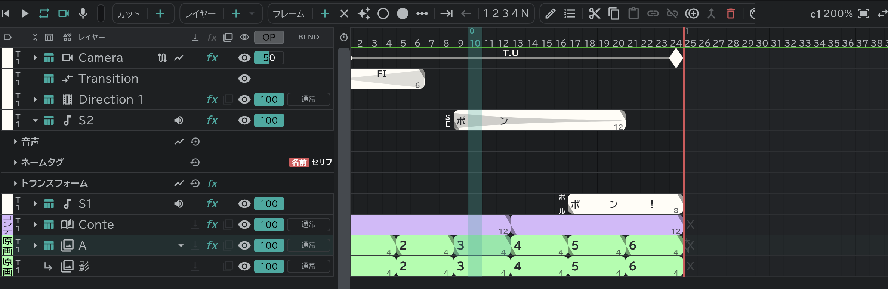

# サウンド(SE)レイヤー

効果音・セリフを置くレイヤーです。波形を見ながら絵とタイミングを合わせ、名前とセリフは[タイムシート](/ja/sheets)にそのまま記入されます。

## SE の行

- タイムラインの **SE** セクションに、**S1・S2** の2行が最初からあります。もっと必要なら **レイヤー ＋ ▾ → SE**(コンテパネルでは **＋** を押すだけで SE)。
- SE の行は **トラック全体のもの** です。カットをまたいで続く音もひとつのブロックとして置かれ、どのカットから見ても同じ行です。

## ブロックひとつ = 音ひとつ

ブロックを作って(**フレーム ＋**)、**編集** またはダブルクリックで画面を開きます。

| 項目 | 内容 |
|---|---|
| 名前 | 話者の名前など。空欄にすると、カンバスのネームタグのボックスが隠れます |
| タイプ | **ON**(画面内)・**OFF**(画面外)・**MONO**(モノローグ) |
| セリフ | シートの SE 欄に書かれる文 |
| リンクされた音声 | このブロックで鳴らす音のファイル |

## 音を入れる

- **ファイルから**:音のファイルをウィンドウにドラッグ&ドロップするか、**プロジェクト** → **ファイルを開く** → インポート画面で配置先を **SE行** に。
- **メディアパネルから**:その音のメニュー → **配置**。→ [メディアパネルとインポート](/ja/media-pool)
- **録音**:再生ボタンの横の **マイク**を押すと再生ヘッドの位置から録音し、もう一度押すと止まって、そのテイクが SE のブロックとして置かれます。入力が大きすぎて割れたテイクは、ブロックの角が赤く表示されます。→ [再生と録音](/ja/playback)

## 波形と音声レーン

- 波形は SE のブロックの上にいつも薄く表示されます。
- **▸** で開いた **音声** レーンで、音をブロックの中でずらして合わせたり、端をドラッグしてフェードをかけたりします。

## 音量・ミュート (レイヤーオーディオ)

SE の行の名前の横の **スピーカー** ボタンを押すと、その行のミキサーが開きます:**ミュート・ソロ・ゲイン・パン**。

## ネームタグ

ブロックの名前は、カンバスに **ネームタグ** としても表示されます。ネームタグは、カメラフレームの中の位置を保ちます。

- **ネームタグ** レーン:サイズ・字間・太字・斜体・下線・取り消し線・名前の色・ボックスの色・セリフの色・セリフを表示。
- ネームタグも、レイヤーと同じように **トランスフォーム**・合成モード・**エフェクト** を受けます。

## 知っておくこと

- SE の行には絵を描きません。クリッピングもありません。
- SE の行そのものはコピー・貼り付けができません。
- 動画・連番を書き出すときに **音声** を **SEミックスを動画に多重化** にすると、音もいっしょに入ります。→ [書き出し](/ja/export)
