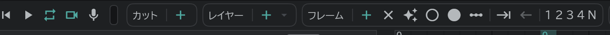

# はじめに

ボールが跳ねる短い場面を例に、描くまでに必要なことだけをまとめます。

## カットとレイヤー

- 新しいプロジェクトは、カットひとつ、作画レイヤー A、最初のコマの絵まである状態で開くので、すぐに描けます。
- タイムライン上部の **カット ＋** でカットを、**レイヤー ＋** で作画レイヤーを作ります。新しく作ったカットには作画レイヤーがないので、**レイヤー ＋** で作ります。

## フレーム

- レイヤーの行でコマを選び、**フレーム ＋** を押すと、そこに絵ができます。範囲を選ぶと、範囲全体にできます。
- **✦**(フレーム自動生成)をオンにしておけば、空いたコマに描くだけでできます。ブロックの頭ではないコマに描くと、そこでブロックが分かれて新しい絵になります。

## 描く

- 左のツールバーでブラシを選び、カンバスに描きます。ブラシの種類は左上のリストから選びます。
- サイズと不透明度は画面右上で変えます。鉛筆ボタンで数値を直接入力できます。ウィンドウが狭いときは **⋯** ボタンの中に入ります。

## 再生と保存

- タイムライン右下の **▶** で再生します。再生のしかたは ⚙ → **プロジェクト設定** の **再生方式** で選びます。
- 左上の **プロジェクト**(フォルダ)ボタン → **保存** で保存します。
- 開くのは同じメニューの **ファイルを開く…**・**フォルダを開く…** です。ファイルをウィンドウにドラッグ&ドロップしてもかまいません。プロジェクト(.anicel・.tvpp・.clip)は新しいタブで開き、絵・音・動画は **インポート** 画面に入ります。

## パネルの大きさ

パネルの縁をドラッグすると大きさが変わります。マウスを乗せると、その縁が明るくなります。

- 下のパネル(タイムライン・コンテ):カンバス側の縁で高さ、左右の縁で幅。左右の縁をダブルクリックすると既定の幅に戻ります。

- 横のパネル:カンバス側の縁で幅、下の縁で高さ。同じ側のパネルは幅をいっしょに使います。
- 角をドラッグすると、幅と高さが一度に変わります。
