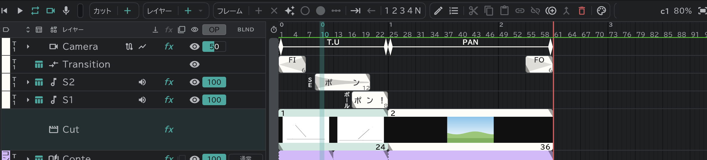

# コンテ

カットを並べておく場所です。**Video** 行のブロックひとつがカットひとつで、カットごとに大きさが違っても続けて再生できます。

- コンテ作業は、カットごとに[コンテレイヤー](/ja/conte-layer)を作って行います。**Video** 行のすぐ下の **Conte** 行にコンテの画面が描かれ、画面ひとつが[コンテ用紙](/ja/sheets)の画面ひとつになります。絵がまだない画面は薄く見えます。
- **Video** 行ではカットを選び、動かし、長さを変えます。**Conte** 行では画面を選び、長さを変えます。ブロックをダブルクリックすると、カット名や画面の名前を変えます。
- CAM 区画のいちばん上のカメラ行に、カットごとのカメラのキーと動き(PAN・T.U・T.B)が見えます。[トランジション](/ja/camera-section)の O.L はここで編集します。
- レールの行はドラッグして順番を変えます。
