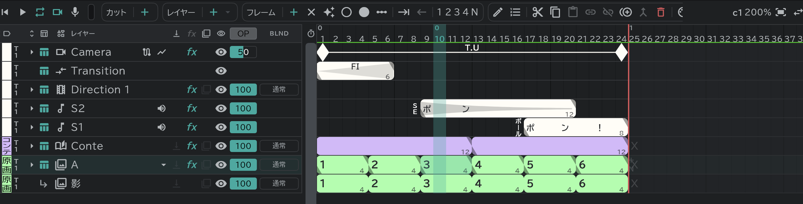
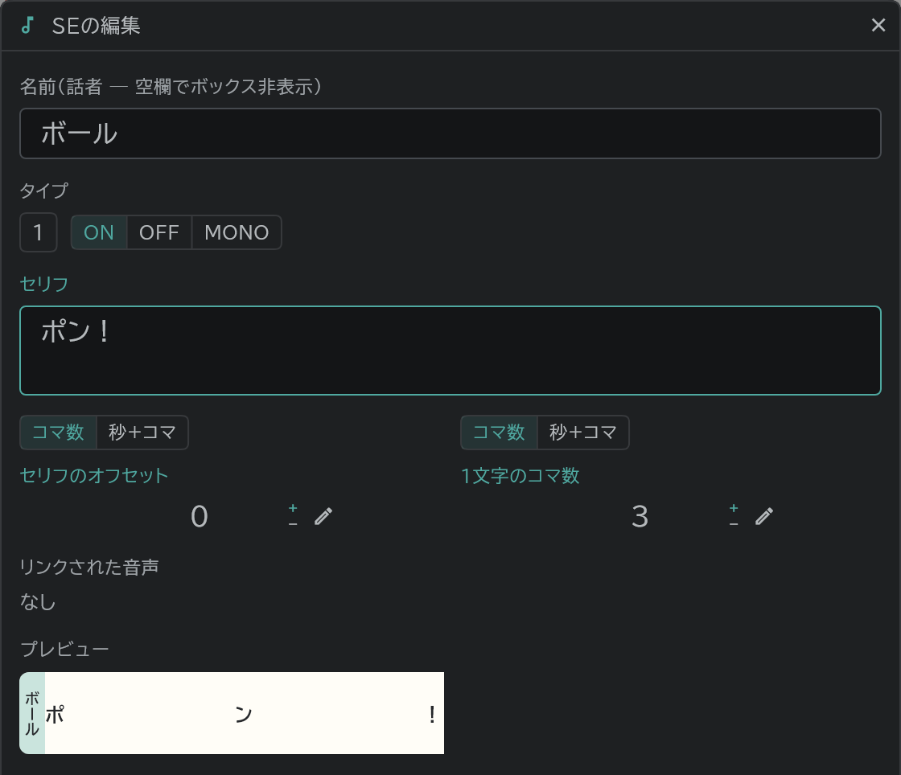

# タイムライン

一行がひとつのレイヤー、横が時間(フレーム)です。

- 上から **CAM**(カメラ・トランジション・ディレクション)、**SE**(音・セリフ)、その下の **ACTION** が作画レイヤーです。
- ブロックひとつが絵一枚です。大きい数字は絵の名前、ブロックの端の小さい数字はそのブロックの長さ(フレーム数)です。
- 行の左の色は[カラーラベル](/ja/layer-labels)です。
- パネル左下のタブで、タイムラインと[コンテ](/ja/storyboard)を切り替えます。

## 選択と移動

フレーム・レイヤー・[コンテ](/ja/storyboard)パネルのカットブロック、どれも同じです。

- 最初のドラッグで **選択** します(ひとつでも複数でも)。
- 選んだところをもう一度ドラッグすると **移動** します。複数の行にまたがる選択は、どの行でつかんでもいっしょに動きます。
- 動かした絵が、その行の同じ名前の絵の上に置かれると、リンクするかたずねます。

## 編集ボタン

ブロックを選んで上の **✎**(編集)を押すと、選んだものに合った画面が開きます。ブロックをダブルクリックしても同じです。

- 絵のブロック(作画・コンテ・画像レイヤー):絵の名前
- SE のブロック:名前(話者)・セリフ、タイプ(ON・OFF・MONO)、リンクされた音声
- ディレクションのブロック:指示(PAN など)
- トランジションのブロック:転換の種類(FI・FO など)。長さはブロックの端をドラッグして変えます。
- カメラなどのレーンのキー:キー名、イン・アウトの速度、位置キーのパス・ロービング([カメラ](/ja/camera-section))
- レイヤーを選べばレイヤー名(複数まとめて)、[コンテ](/ja/storyboard)パネルでカットを選べばカット名

## 中割りマーク

- フレーム側の **●** は、選んだコマに中割りマークを付けたり消したりします。
- 隣の **中割りマークを自動追加** に数 n を入れると、選んだブロックに頭から n コマごとに付けます。

## レーンとグラフ

- 行の左の **▸** で開くと、トランスフォーム・エフェクトなどのレーンが出て、レーンごとにキーを置きます。数値の欄はドラッグして変えるか、鉛筆ボタンで直接入力します。
- トランスフォーム・エフェクトの見出し行とカメラの行の **グラフ** ボタンで、そのまとまりのグラフを開きます。**値**・**速度** を切り替えて見て、キーをドラッグして動かしたり、ハンドルで緩急を調整したりします。

## 表示とソロ

- レールのいちばん上の見出し行の欄を押すと、**すべて表示**・**すべて隠す** や **種類をソロ**・**色をソロ** などのメニューが開きます。ソロは[コンテ](/ja/storyboard)パネルでも同じように動きます。
