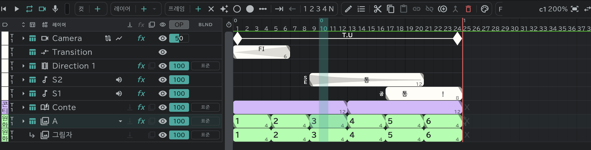

# 애니메이션 레이어

그림을 칸마다 그려 움직이게 하는 기본 레이어입니다. 새 프로젝트의 **A** 가 이 레이어입니다.

## 블록과 칸

- 가로 한 칸이 1프레임입니다. 색이 칠해진 **블록** 하나가 그림 한 장이고, 블록의 길이가 그 그림이 보이는 코마 수입니다.
- 블록 안의 큰 숫자가 **그림 이름**, 블록 끝의 작은 숫자가 **길이** 입니다.
- 블록이 없는 칸은 **빈 칸**(아무것도 안 보임, 시트의 ×)입니다.
- 새 레이어는 이름이 **A · B · C …** 로 붙고, 색 라벨은 **레이아웃 소재** 로 시작합니다. → [색 라벨과 테이크](/ko/layer-labels)

## 그림 만들기

- 칸을 고르고 **프레임** 알약의 **＋** 새 프레임: 그 칸에 새 그림. 블록 한가운데서 누르면 블록이 거기서 둘로 나뉩니다.
- **✦**(프레임 자동 생성)를 켜 두면 빈 칸에 그리기만 해도 그림이 생깁니다.
- 블록 끝의 삼각형을 끌면 길이가 바뀝니다. 고른 블록 전부의 길이는 **1 · 2 · 3 · 4 · N** 코마으로 한꺼번에 정합니다. 뒤의 블록은 그만큼 당겨지거나 밀립니다.
- **밀기 / 당기기** 는 고른 자리에 빈 칸을 열거나 닫습니다.
- **×**(비우기)는 고른 칸을 빈 칸으로 만듭니다.

## 같은 이름 = 같은 그림

- 그림 이름이 같은 블록은 **같은 그림** 입니다. 한쪽을 고치면 다른 쪽도 바뀝니다(시트의 반복 표기와 같습니다).
- 블록 이름을 이미 있는 이름으로 바꾸면 **링크할 프레임** 을 묻습니다.
- **링크 붙여넣기**는 같은 그림으로, **독립 붙여넣기**는 새 그림으로 붙입니다. 링크된 것을 떼려면 **링크 독립**. → [타임라인](/ko/timeline?id=공용-알약)
- **자동 이름 지정** 은 고른 블록에 시작 번호부터 차례로 이름을 붙입니다.

## 묶음 끝의 ＋ 와 홀드 · 반복

빈 칸 없이 붙어 있는 블록들의 **묶음** 양 끝에 작은 **＋** 와 성질 표시가 붙습니다.

- **＋**: 누르면 끝에 그림 한 장을 더하고, 끌면 끈 만큼 여러 장을 더합니다.
- 성질 표시를 누르면 묶음 바깥의 빈 칸을 어떻게 할지 고릅니다. 결과는 컷 끝(또는 처음)까지 **흐린 블록** 으로 채워집니다.

| 성질 | 하는 일 |
|---|---|
| 없음 | 빈 칸 그대로 |
| **홀드** | 끝 그림이 컷 끝까지 그대로 보입니다 |
| **반복** | 묶음 전체가 컷 끝까지 되풀이됩니다 |
| **선택 영역 반복** | 묶음 중 고른 부분만 되풀이됩니다(고른 범위가 있을 때) |

흐린 블록은 묶음을 따라 저절로 다시 계산됩니다. 묶음을 고치거나 컷 길이를 바꾸면 따라 바뀝니다.

## 중간나누기 마크

동화(중간 그림) 지시용 표시입니다. ○ 와 ● 두 가지가 있습니다.

- **○ 마크1 · ● 마크2**: 고른 칸에 찍거나 지웁니다.
- **중간나누기 마크 자동 추가**: 간격 n 과 ○/● 를 정하면 고른 블록에 머리부터 n 코마마다 찍습니다.
- **이름을 붙이지 않은 그림** 은 블록 머리에 이름 대신 마크가 보입니다. ○ · ● 중 어느 쪽으로 보일지는 [환경설정](/ko/preferences) → **화면** → **이름 없는 블록의 마크** 에서 고릅니다(자동 추가 창도 처음에는 이 마크로 열립니다).

## 이 레이어에서 되는 것

어태치 레이어의 본 레이어 · 클리핑 · [어니언 스킨](/ko/onion-skin) · [이펙트와 변형](/ko/effects) · 블렌드 · 불투명도.
