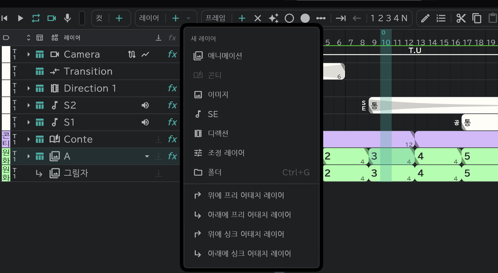

# 어태치 레이어

본 레이어에 붙어 이동·효과를 함께 따라가고, 그림은 따로 갖는 레이어입니다. 그림자나 하이라이트에 씁니다.

- 본 레이어를 고르고 **레이어 ＋ ▾** 에서 위/아래 **싱크**·**프리** 어태치 레이어를 고릅니다. 레이어를 다른 레이어 위로 끌어다 놓아도 붙습니다.
- **싱크**: 본 레이어의 타이밍을 그대로 따라갑니다.
- **프리**: 타이밍은 따로 정합니다.
- 떼어 낼 때는 **레이어** → **어태치 해제** 입니다.
- 새 어태치 레이어의 번호는 그 본 레이어에 붙은 것끼리 셉니다.
